<p align="center">
  <a href="https://www.npmjs.com/package/@kesha-antonov/react-native-chat"></a>
  <a href="https://www.npmjs.com/package/@kesha-antonov/react-native-chat"></a>
  <a href="https://npm-stat.com/charts.html?package=%40kesha-antonov%2Freact-native-chat&from=2015-01-01"></a>
  <a href="https://www.npmjs.com/package/@kesha-antonov/react-native-chat"></a>
  <a href="https://github.com/kesha-antonov/react-native-chat/actions/workflows/main.yml"></a>
  
  
  
</p>

<h1 align="center">React Native Chat</h1>

<p align="center">
  The most complete chat UI for React Native &amp; Web
</p>

<p align="center">
  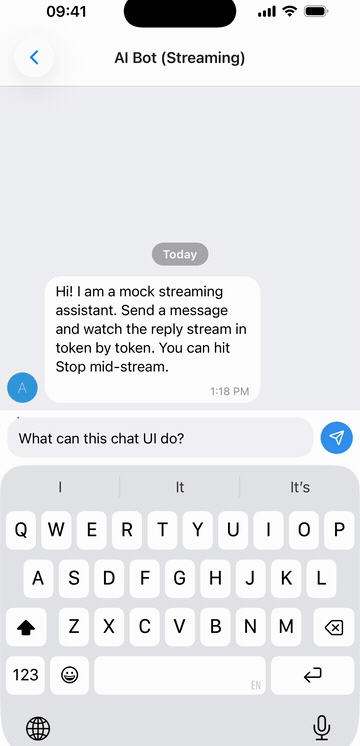
</p>

<p align="center">
  <a href="https://snack.expo.dev/@kesha-antonov/react-native-chat-playground" target="_blank">
    
  </a>
</p>

<p align="center">
  <strong>Coming from <code>react-native-gifted-chat</code>?</strong> This is a drop-in replacement -
  same <code>IMessage</code>, same props, a few renamed exports.
  <br/>
  <a href="docs/MIGRATION.md">Migrate in one command with the codemod →</a>
</p>

<p align="center">
  <strong><a href="https://kesha-antonov.github.io/react-native-chat/">📖 Documentation</a></strong> &nbsp;·&nbsp;
  <a href="https://kesha-antonov.github.io/react-native-chat/installation">Installation</a> &nbsp;·&nbsp;
  <a href="https://kesha-antonov.github.io/react-native-chat/usage">Usage</a> &nbsp;·&nbsp;
  <a href="https://kesha-antonov.github.io/react-native-chat/props">Props</a> &nbsp;·&nbsp;
  <a href="https://kesha-antonov.github.io/react-native-chat/guides">Guides</a>
</p>

<p align="center">
  <sub>Using it in production? A ⭐ helps other developers find the library.</sub>
</p>

<!-- cryptoc-promo:start -->
<hr />

<h2 align="center">Sponsors</h2>

<p align="center">
  <a href="https://getstream.io/chat/sdk/react-native/?utm_source=github&utm_medium=sponsor&utm_campaign=keshaantonov&utm_term=react-native-chat"></a>
  <br />
  <a href="https://getstream.io/chat/sdk/react-native/?utm_source=github&utm_medium=sponsor&utm_campaign=keshaantonov&utm_term=react-native-chat"><strong>Stream</strong></a> - React Native Chat SDK
</p>

<hr />

<table align="center">
<tr>
<td align="center" valign="top" width="190">
  <a href="https://cryptoc-app.web.app/"></a>
  <br /><br />
  
  <br />
  <sub>Scan to install</sub>
  <br /><br />
  <!-- App Store button hidden for now
  <a href="https://apps.apple.com/app/cryptoc/id1333169178"></a>
  <br />
  -->
  <a href="https://play.google.com/store/apps/details?id=co.ssoul.CryptoC"></a>
</td>
<td valign="top">

### Support my work

**[cryptoc](https://cryptoc-app.web.app/)** - my crypto portfolio app. Your coins on the home screen, lock screen and watch face. iPhone, iPad, Mac, Apple Watch, Android, Android tablet and Wear OS.

- Portfolio with average buy price and 24h / 180-day / all-time P&L
- Widgets in three sizes, refreshed in the background - most days you never open the app
- Price alerts on 5,000+ coins, delivered while the app is closed
- **No account, no email, no exchange API keys, no ads.** Your holdings never reach a server - they sync through your own iCloud or Google Drive
- Free for 3 holdings, and that is not a trial timer

<sub>Downloading it is what pays for the time that goes into these libraries.</sub>

</td>
</tr>
</table>

<hr />
<!-- cryptoc-promo:end -->

## Quick start

```bash
npx expo install @kesha-antonov/react-native-chat react-native-reanimated react-native-gesture-handler react-native-safe-area-context react-native-keyboard-controller
```

```jsx
import { useCallback, useState } from 'react'
import { Chat } from '@kesha-antonov/react-native-chat'

export function Example () {
  const [messages, setMessages] = useState([
    {
      _id: 1,
      text: 'Hello developer',
      createdAt: new Date(),
      user: { _id: 2, name: 'John Doe', avatar: 'https://placeimg.com/140/140/any' },
    },
  ])

  const onSend = useCallback((newMessages = []) => {
    setMessages(previous => Chat.append(previous, newMessages))
  }, [])

  return <Chat messages={messages} onSend={onSend} user={{ _id: 1 }} />
}
```

That is the whole setup - everything below is optional.

---

## ✨ Features

- 💬 **[Chat list](#chat-list)** - the list of chats with search, selection actions, archive, swipe to archive and draggable pinned chats; plug in your backend
- 🌗 **[Dark mode & theming](#theming--dark-mode)** - full light/dark token system, switchable at runtime
- 🤖 **[Streaming AI messages](#streaming-ai-messages)** - token-by-token replies with a typing caret and stop control
- 😀 **[Emoji reactions](#emoji-reactions)** - long-press picker and reaction pills
- ⌨️ **[Emoji keyboard](#emoji-keyboard-and-attachment-menu)** - a full emoji panel in the keyboard's place, with search, recents and skin tones
- 📎 **[Attachment menu](#emoji-keyboard-and-attachment-menu)** - photo grid with numbered selection and a caption, files and location
- 🎥 **[Video & audio messages](#-whats-new-vs-react-native-gifted-chat)** - real inline playback, with a tappable fallback
- 🎙️ **[Voice & video recording](#-whats-new-vs-react-native-gifted-chat)** - hold-to-record voice and round video notes, on once their peers are installed
- 👋 **[Empty chat greeting](#messages--message-container)** - a "No messages here yet..." card with a tap-to-send 👋
- 😍 **[Big emoji](#theming--dark-mode)** - emoji-only messages drop the bubble and draw large
- 🔵 **[Unread bar](#messages--message-container)** - "Unread Messages" above the first unread message, opened scrolled to it
- 🔗 **[Link previews](#message-bubbles--content)** - a web page block under the text
- ☑️ **[Multi-select](#message-bubbles--content)** - "Select" in the long-press menu: check circles, Copy / Forward / Delete bar
- 📍 **[Location messages](#-whats-new-vs-react-native-gifted-chat)** - map card that opens the system maps app
- ↩️ **[Swipe to reply](#reply-to-messages)** - reply preview and message threading
- 📋 **[Long-press actions](#message-actions-long-press-context-menu)** - a context menu beside the finger, with a reactions bar
- ⚡ **[Quick replies](#quick-replies)** - bot-style reply buttons
- 🔗 **[Smart link parsing](#smart-link-parsing)** - URLs, emails, phones, hashtags, mentions
- 👤 **[Avatars](#avatars)** - user initials or custom images
- ✍️ **[Typing indicator](#typing-indicator)** - show when someone is typing
- ⏮️ **[Load earlier messages](#load-earlier-messages)** - pagination and infinite scroll
- ⬇️ **[Scroll to bottom](#scroll-to-bottom)** - quick jump back to the latest
- ✅ **[Message status](#message-status)** - ticks for sent, delivered and read
- 💬 **[System messages](#system-messages)** - in-line notifications
- 🌍 **[Localized dates & i18n](#localization-i18n)** - Day.js dates, translated UI strings
- ⌨️ **[Keyboard handling](#keyboard--layout)** - smart avoidance on every platform
- 🎨 **[Fully customizable](#-props-reference)** - override any component with your own
- 📱 **[Expo](#-installation)** & 🌐 **[Web](#web-react-native-web)** - works with Expo and react-native-web
- 📝 **[TypeScript](#typescript)** - complete definitions, generic over your message type

Actively maintained, New Architecture ready, built for the latest Reanimated / Gesture Handler.

<p align="center">
  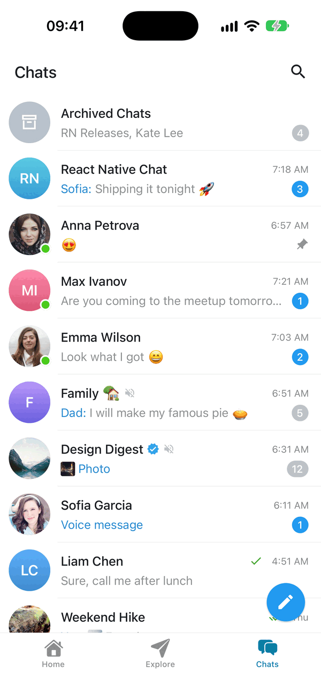
  &nbsp;&nbsp;
  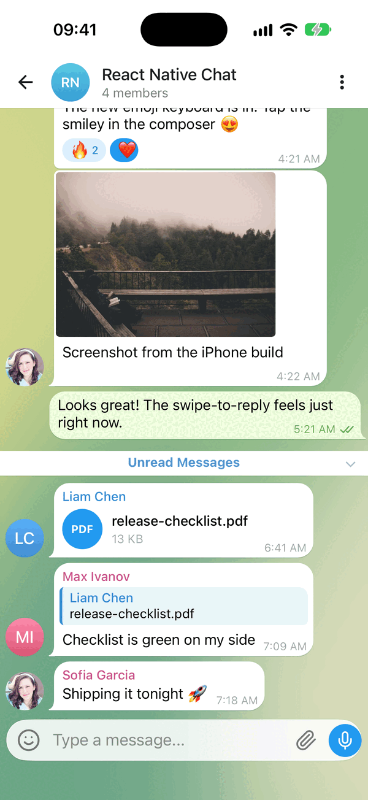
  &nbsp;&nbsp;
  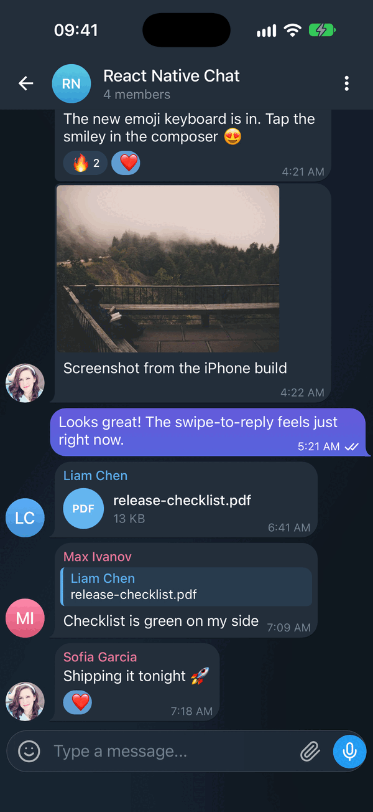
</p>

<p align="center">
  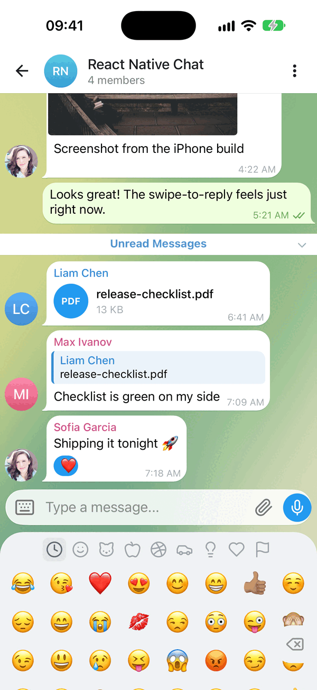
  &nbsp;&nbsp;
  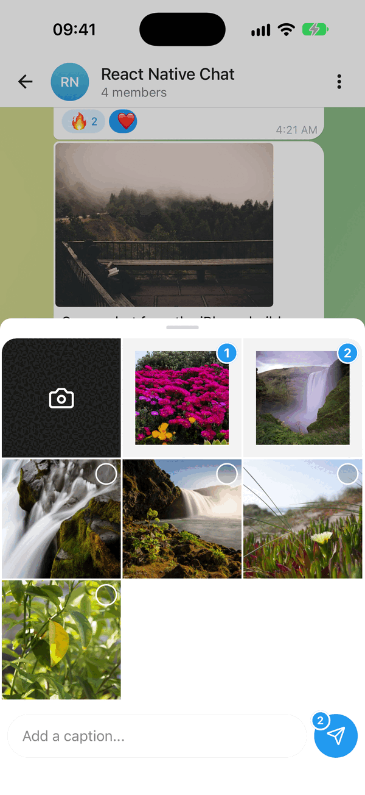
  &nbsp;&nbsp;
  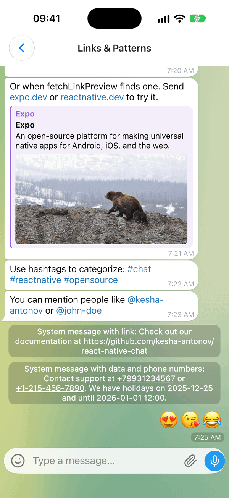
</p>

<p align="center">
  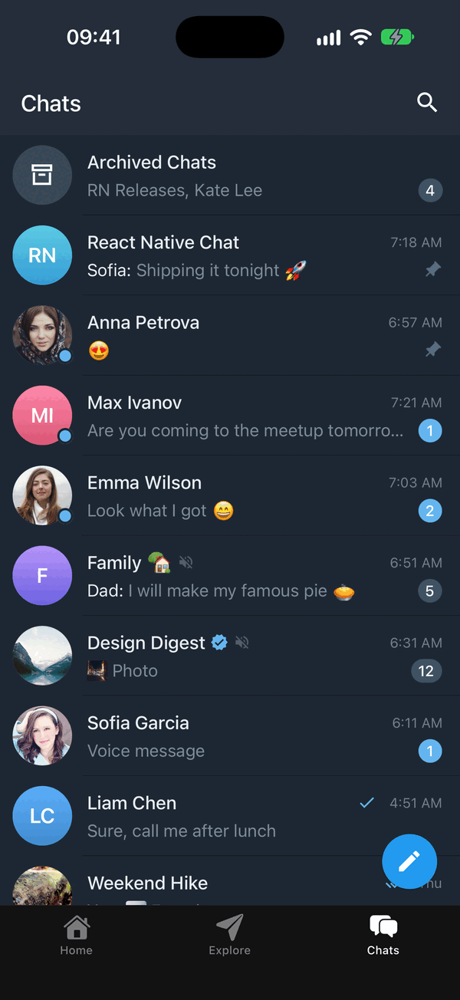
</p>

---

## 🆕 What's new vs react-native-gifted-chat

Kept in sync with upstream [`react-native-gifted-chat`](https://github.com/FaridSafi/react-native-gifted-chat)'s latest `master`, so you **keep everything it already has** - and the same `IMessage` model and prop names. Everything added here is **non-breaking and opt-in**; the media and recording features only activate once you install their optional peer deps.

<details>
<summary><strong>Side-by-side comparison</strong></summary>

| Added in this fork | react-native-gifted-chat | @kesha-antonov/react-native-chat |
| --- | :---: | :---: |
| Active maintenance | 💤 sporadic | ✅ active |
| Modern default UI (modern messenger look) | dated 2020 look | ✅ wallpaper, tails, inline time, fully overridable |
| Light/Dark **theme system** | per-component color props | ✅ `theme` / `darkTheme` tokens, runtime switch |
| Streaming (AI) messages | ❌ | ✅ token-by-token + typing cursor |
| Emoji reactions | ❌ | ✅ long-press picker + reaction pills |
| Emoji keyboard | ❌ | ✅ built in: tabs, search, recents, skin tones |
| Attachment menu | ❌ (`actions` sheet) | ✅ built in: photo grid + caption, files, location |
| File messages | ❌ | ✅ `IMessage.file` document bubble |
| Swipe-to-reply + reply preview | ❌ | ✅ built in |
| **Video / audio messages** | "not implemented, render your own" | ✅ inline players + tappable fallback |
| **Voice notes** (hold-to-record + waveform) | ❌ | ✅ optional |
| **Video messages** (round camera notes) | ❌ | ✅ optional |
| **Location messages** | ❌ ignored | ✅ map card → opens system maps |
| Bubble tails, inline time + run grouping | flat bubbles | ✅ |

</details>

### Theming in one line

<details>
<summary><strong>Override any token, light and dark</strong></summary>

```jsx
// Modern defaults out of the box, or override any token (light + dark):
<Chat
  theme={{ colors: { accent: '#3390EC', outgoingBubble: '#EFFEDE' } }}
  darkTheme={{ colors: { background: '#0E1621' } }}
  {...props}
/>
```

</details>

### Voice, video and location

<details>
<summary><strong>Recording and media playback</strong></summary>

Voice notes (`expo-audio`) and round video notes (`react-native-vision-camera`) turn on by themselves once their peers are installed: the mic button records on hold, and a tap switches it to the camera. Pass `false` to turn either off.

```jsx
<Chat
  videoRecording={{ maxDuration: 30 }}   // optional: configure; `false` turns round notes off
  mediaPlayback={{ playbackRate: 1.5 }}  // optional: start notes at 1.5x, auto-play the next note
  // location messages render automatically for any IMessage with a `location`
  {...props}
/>
```

```bash
# Optional inline media playback + recording:
npx expo install expo-video expo-audio expo-image-picker
# Optional: round video notes and the voice-note waveform
# (vision-camera 5+, which runs on Nitro and needs its two Nitro packages too)
npx expo install react-native-vision-camera react-native-nitro-modules react-native-nitro-image react-native-audio-api react-native-svg expo-haptics
# Optional: trim paused voice takes, blur behind the round-video camera
npx expo install expo-file-system expo-blur
```

Recording and playback work like this:

- **Hold** the record button to record, release to send. With both voice and video enabled, a **tap** switches it between mic and camera, and the choice is remembered. With only video, the camera sits in the record button's place.
- **Slide left** to cancel: all the way across cancels at once; releasing past about half the way cancels too. **Slide up** to lock and keep recording hands-free. The two exclude each other: no lock once the cancel slide is under way. "Slide up to lock" is shown for the first few takes.
- **Locked**, the bar shows a `m:ss,t` timer and a CANCEL button, and the lock turns into a **pause** button: pausing stops the take into a preview - the voice note's waveform with play, or the round note looping in its circle (tap to hear it) - to send or delete.
- In a paused voice take, the mic above send **resumes** recording onto its end, and the handles at either end of the waveform **trim** it. Resuming needs `react-native-audio-api`; trimming also needs `expo-file-system`, and a trimmed take is sent as a WAV. Round video takes can't be resumed or trimmed.
- A round note records on the first hold, with the camera drawn over a blurred chat (when `expo-blur` is installed). Switch camera and flash work while recording (the screen lights up for the front camera, the torch for the back one), and you can pinch to zoom. At its 60s limit the take stops into the preview instead of sending.
- Haptic ticks on start, stop, lock and mode switch when `expo-haptics` is installed.
- Starting a recording pauses any note that is playing.
- Only one note plays at a time. When a voice or round video note plays to its end, the next newer one in the chat starts.
- While a note plays or is paused, a "now playing" bar at the top of the chat has play/pause, the sender, the speed (1x / 1.5x / 2x; long-press for more, shared by every note) and close; a tap on the title scrolls to the note.
- Round notes rest in the list on their first frame with a play button (or loop silently with `isRoundVideoAutoplayEnabled`). A tap plays one from the start with sound and grows it, hiding the sender's avatar; a tap pauses it, and a paused note can be scrubbed by dragging around its ring. Its length, in a pill at its bottom-left, counts down while it plays, and playing bars replace its unread dot once it is heard.
- Set `isMediaUnread` on a message for the unread dot; `mediaPlayback.onMediaRead` reports when an incoming one is played.

</details>

### Emoji keyboard and attachment menu

<details>
<summary><strong>Built in, on by default</strong></summary>

The composer's emoji button opens the built-in emoji keyboard in the system keyboard's place - at the last keyboard height, so switching between the two keeps the composer still. It has the category tabs, search (scroll the grid up to reveal it), recents by use count, a skin-tone popup on long-press and a repeating backspace. A tap inserts at the caret whether or not you control `text`.

The paperclip opens the built-in attachment menu: your newest photos in a 3-column grid (with `expo-media-library`), numbered as you pick them, a caption and a "Send N" button; File and Location tabs; a camera tile. Picks arrive in `onSend` as ordinary messages - `image`, `video`, `file` (`{ uri, name, size?, mimeType? }`) or `location` - so there is nothing to wire.

```bash
# Each tab shows only when its package is installed:
npx expo install expo-media-library expo-image-picker expo-document-picker expo-location
# Optional: keep emoji recents across launches, share received files, fast ph:// thumbnails
npx expo install @react-native-async-storage/async-storage expo-sharing expo-image
```

```tsx
<Chat
  emojiKeyboard={{ columns: 8, recents: { storageKey: 'my-app/emoji' } }}
  attachments={{
    tabs: ['gallery', 'file'],
    // Upload first, then send what your backend returns (or `null` to send nothing).
    onPick: async (picked, { caption }) => upload(picked, caption),
  }}
  {...props}
/>
```

Hide either with `emojiKeyboard={false}` / `attachments={false}`. `onPressEmoji` replaces the emoji keyboard and `actions` / `onPressActionButton` / `renderActions` replace the attachment menu, as before.

**Permissions.** iOS kills an app that asks for a permission without a usage string. In Expo, list the plugins with your own strings (the defaults are generic):

```json
"plugins": [
  ["expo-image-picker", { "photosPermission": "...", "cameraPermission": "..." }],
  ["expo-media-library", { "photosPermission": "...", "savePhotosPermission": "...", "granularPermissions": ["photo", "video"] }],
  ["expo-location", { "locationWhenInUsePermission": "..." }],
  "expo-document-picker",
  "expo-sharing"
]
```

In a bare app add the keys yourself, then rebuild the native app:

| Package | iOS `Info.plist` | Android manifest |
|---|---|---|
| `expo-media-library` | `NSPhotoLibraryUsageDescription` (`NSPhotoLibraryAddUsageDescription` to save) | `READ_MEDIA_IMAGES`, `READ_MEDIA_VIDEO` (`READ_EXTERNAL_STORAGE` below Android 13) |
| `expo-image-picker` | `NSPhotoLibraryUsageDescription`, `NSCameraUsageDescription` (`NSMicrophoneUsageDescription` for video) | `CAMERA` (and `RECORD_AUDIO` for video) |
| `expo-location` | `NSLocationWhenInUseUsageDescription` | `ACCESS_COARSE_LOCATION`, `ACCESS_FINE_LOCATION` |
| `expo-document-picker` | none (iCloud documents need the iCloud entitlement) | none |
| `expo-sharing` | none | none |

</details>

### Custom icons (e.g. Lucide)

<details>
<summary><strong>Override any built-in icon</strong></summary>

Built-in icons are the official [Lucide](https://lucide.dev) glyphs, rendered via the optional `react-native-svg` peer when it is installed, or drawn with `View`s (no dependency) otherwise. Override any of them via the `icons` prop - the built-in icon is used for anything you don't override:

```tsx
import { Send, Mic } from 'lucide-react-native'

<Chat
  icons={{
    send: ({ color, size }) => <Send color={color} size={size} />,
    mic:  ({ color, size }) => <Mic color={color} size={size} />,
  }}
  {...props}
/>
```

Overridable names: `send`, `mic`, `camera`, `play`, `pause`, `check`, `checkAll`, `clock`, `pin`, `plus`, `close`, `chevronLeft`, `chevronDown`, `emoji`, `paperclip`, `reply`, `pencil`, `lock`, `trash`.

</details>

---

<h3 align="center">Support This Project</h3>

<p align="center">
  I maintain this project in my free time with no compensation. If you find it useful and want to help keep it alive, please consider sponsoring. Your support means a lot! 💖
  <br><br>
  <a href="https://github.com/sponsors/kesha-antonov">
    
  </a>
</p>

---

> **Using an AI coding agent?** [`llms.txt`](llms.txt) is a condensed integration guide for
> agents adding this library to an app, and [`AGENTS.md`](AGENTS.md) covers working inside
> this repository.

## 📖 Table of Contents

- [Quick start](#quick-start)
- [Features](#-features)
- [What's new vs react-native-gifted-chat](#-whats-new-vs-react-native-gifted-chat)
- [Requirements](#-requirements)
- [Installation](#-installation)
- [Migrating from react-native-gifted-chat](#-migrating-from-react-native-gifted-chat)
- [Usage](#-usage)
- [Data Structure](#-data-structure)
- [Props Reference](#-props-reference)
- [Guides](#-guides)
  - [Chat List](#chat-list)
  - [Reply to Messages](#reply-to-messages)
  - [Maintaining Scroll Position (AI Chatbots)](#maintaining-scroll-position-ai-chatbots)
  - [Streaming (AI) Messages](#streaming-ai-messages)
  - [Emoji Reactions](#emoji-reactions)
  - [Smart Link Parsing](#smart-link-parsing)
  - [Message actions](#message-actions-long-press-context-menu)
  - [Theming & Dark Mode](#theming--dark-mode)
  - [Localization (i18n)](#localization-i18n)
  - [Message Status](#message-status)
  - [TypeScript](#typescript)
- [Platform Notes](#-platform-notes)
- [Performance](#-performance)
- [Testing](#-testing)
- [Example App](#-example-app)
- [Troubleshooting](#-troubleshooting)
- [Contributing](#-contributing)
- [Authors](#-authors)
- [License](#-license)

---

## 📋 Requirements

| React Native | React | iOS | Android | Expo | TypeScript |
|---|---|---|---|---|---|
| >= 0.82.0 | >= 19 | >= 15.1 | API 24+ (7.0) | SDK 55+ | >= 5.0 (optional) |

The floor comes from `react-native-gesture-handler` 3, which the library is built on (3.0+ is required; it supports React Native 0.82 and newer). The example app runs Expo SDK 58 with React Native 0.88.

---

## 📦 Installation

### Expo Projects

```bash
npx expo install @kesha-antonov/react-native-chat react-native-reanimated react-native-gesture-handler react-native-safe-area-context react-native-keyboard-controller
```

### Bare React Native Projects

<details>
<summary><strong>Three steps</strong></summary>

**1.** Install the packages. Reanimated 4 also needs `react-native-worklets`; leave it out on Reanimated 3:

```bash
yarn add @kesha-antonov/react-native-chat react-native-reanimated react-native-worklets react-native-gesture-handler react-native-safe-area-context react-native-keyboard-controller
```

```bash
npm install --save @kesha-antonov/react-native-chat react-native-reanimated react-native-worklets react-native-gesture-handler react-native-safe-area-context react-native-keyboard-controller
```

**2.** Add the worklets Babel plugin as the last entry in `babel.config.js` - `react-native-worklets/plugin` on Reanimated 4, `react-native-reanimated/plugin` on Reanimated 3 - following the [react-native-reanimated installation guide](https://docs.swmansion.com/react-native-reanimated/docs/fundamentals/getting-started/).

**3.** Install iOS pods, then **rebuild the native app** (`npx react-native run-ios` / `run-android`) and restart Metro with `--reset-cache`. every peer above ships native code, so reloading the JS bundle alone is not enough:

```bash
npx pod-install
```

</details>

### Optional peers

Every feature below turns itself on when its package is installed and stays hidden when it is not - there is nothing to configure. `getChatCapabilities()` reports what the current install can do, e.g. to build UI that matches the chat's. In development, a feature that was asked for but cannot work (say `audioRecording={{ isEnabled: true }}` without `expo-audio`) logs one hint.

| Package | Feature | `getChatCapabilities()` key |
|---|---|---|
| `expo-clipboard` or `@react-native-clipboard/clipboard` | "Copy" in the long-press menu | `clipboard` |
| `expo-haptics` | Haptic ticks (long-press, swipe-to-reply, recording) | `haptics` |
| `expo-blur` | Blurred backdrop behind the menu and the round video recorder | `blur` |
| `react-native-svg` | Lucide icons and vector rings | `svg` |
| `expo-audio` | Voice playback and hold-to-record voice notes | `audioPlayback`, `voiceRecording` |
| `react-native-audio-api` | Voice waveforms, resume and trim | `waveform` |
| `expo-video` | Inline video and round video notes | `videoPlayback` |
| `react-native-vision-camera` 5 | In-chat round video capture | `roundVideoCapture` |
| `expo-image-picker` | System camera fallback for video notes | `videoRecording` |
| `react-native-streamdown` | Rich streaming markdown | `markdown` |
| `@lodev09/react-native-true-sheet` | Native attachment sheet | `nativeSheet` |
| `@shopify/flash-list` | The FlashList list engine | `flashList` |
| `expo-media-library` | The attachment menu's photo grid | `mediaLibrary` |
| `expo-image-picker` | The attachment menu's system photo picker and camera | `imagePicker` |
| `expo-document-picker` | The attachment menu's File tab | `documentPicker` |
| `expo-location` | The attachment menu's Location tab | `location` |
| `expo-sharing` | Opening a received file in the share sheet (otherwise `Linking`) | `sharing` |
| `@react-native-async-storage/async-storage` | Emoji recents and skin tones kept across launches | `persistentEmojiRecents` |
| `expo-image` | Gallery thumbnails straight from the photo library | - |

---

## 🔄 Migrating from react-native-gifted-chat

**The API, props, and `IMessage` model are unchanged** - migrating is a package swap plus renaming the `GiftedChat*` identifiers. Full guide with a codemod: **[docs/MIGRATION.md](docs/MIGRATION.md)**.

<details>
<summary><strong>What to rename</strong></summary>

```bash
yarn remove react-native-gifted-chat
yarn add @kesha-antonov/react-native-chat
```

| react-native-gifted-chat | @kesha-antonov/react-native-chat |
| --- | --- |
| `react-native-gifted-chat` | `@kesha-antonov/react-native-chat` |
| `GiftedChat` | `Chat` |
| `GiftedAvatar` | `ChatAvatar` |
| `GiftedChatContext` | `ChatContext` |
| `IMessage`, `User`, `useChatContext`, … | unchanged |

</details>

---

## 🚀 Usage

### Basic Example

See [Quick start](#quick-start) above for the minimal setup. More examples - Slack-style messages, quick replies, custom components - live in the [`example`](example) directory.

---

## 📊 Data Structure

Messages, system messages, and quick replies follow the structure defined in [Models.ts](src/Models.ts).

<details>
<summary><strong>Message object structure</strong></summary>

```typescript
interface IMessage {
  _id: string | number
  text: string
  createdAt: Date | number
  user: User
  image?: string
  /** Tiny stand-in drawn blurred under `image` until it loads: a small image uri, or a blurhash with expo-image */
  imagePlaceholder?: string
  video?: string
  /** Render `video` as a round video note */
  videoNote?: boolean
  audio?: string
  /** Length of `audio` / `video` in seconds */
  duration?: number
  /** The voice or round note has not been played by its recipient yet (unread dot) */
  isMediaUnread?: boolean
  /** View-once voice or round note: plays a single time, then `mediaPlayback.onViewOnceEnd` fires */
  isViewOnce?: boolean
  /** Transcribed text of a voice or round note, shown under it via the transcribe button */
  transcription?: string
  system?: boolean
  sent?: boolean
  received?: boolean
  pending?: boolean
  /** Sending failed: a red badge replaces the checks */
  isFailed?: boolean
  /** The message was edited: its time reads "edited 14:05" */
  isEdited?: boolean
  editedAt?: Date | number
  /** True while the text is still streaming in (shows a typing cursor) */
  streaming?: boolean
  /** Media uploading or downloading: a progress ring with a cancel ✕ ({ type: 'upload' | 'download', progress?, totalBytes? }) */
  transfer?: MediaTransfer
  /** Media not fetched by itself: a download arrow, which calls `mediaTransfer.onDownload` */
  isDownloadRequired?: boolean
  /** A voice note's waveform from the server (0..1, or 0..31 integers), drawn before the audio downloads */
  waveform?: number[]
  quickReplies?: QuickReplies
  replyMessage?: ReplyMessage
  reactions?: MessageReaction[]
  location?: {
    latitude: number
    longitude: number
  }
  /** A document: a file bubble (icon, name, size); a tap opens it */
  file?: {
    uri: string
    name: string
    size?: number
    mimeType?: string
  }
  /** A web page preview under the text (or fetched via `fetchLinkPreview`); `null` hides it */
  linkPreview?: {
    url?: string
    siteName?: string
    title?: string
    description?: string
    image?: string
    imageWidth?: number
    imageHeight?: number
    imageSize?: 'large' | 'small'
  } | null
}

interface ReplyMessage {
  _id: string | number
  text: string
  user: User
  image?: string
  audio?: string
}

interface MessageReaction {
  emoji: string
  userIds: (string | number)[]
}

interface User {
  _id: string | number
  name?: string
  avatar?: string | number | (() => React.ReactNode)
}
```

</details>

---

## 📖 Props Reference

Every group below is collapsed - open the one you need.

<details>
<summary><strong>Core configuration, refs &amp; theming</strong></summary>

### Core Configuration

- **`messages`** _(Array)_ - Messages to display
- **`user`** _(Object)_ - User sending the messages: `{ _id, name, avatar }`
- **`onSend`** _(Function)_ - Callback when sending a message
- **`messageIdGenerator`** _(Function)_ - Generate an id for new messages. Defaults to a simple random string generator.
- **`locale`** _(String)_ - Locale to localize the dates. You need first to import the locale you need (ie. `require('dayjs/locale/de')` or `import 'dayjs/locale/fr'`)
- **`colorScheme`** _('light' | 'dark')_ - Force color scheme (light/dark mode). When set to `'light'` or `'dark'`, it overrides the system color scheme. When `undefined`, it uses the system color scheme. Default is `undefined`.
- **`theme`** _(Object)_ - Override the default light theme tokens (`colors` / `radii` / `spacing` / `typography` / `avatar` / `sendButton` / `composer` / `voice` / `bubble` / `wallpaper` / `nameColors`). Deep-merged over `defaultLightTheme`; any subset is allowed. See [Theming & Dark Mode](#theming--dark-mode).
- **`renderWallpaper`** _(Function | null)_ - The chat background. By default `Chat` draws a swirl gradient from `theme.wallpaper`, turning one step per message you send. Return your own element (an image, `ChatWallpaper` with other props...) to replace it, or pass `null` for the plain `theme.colors.background`.
- **`darkTheme`** _(Object)_ - Same as `theme`, applied when the resolved color scheme is dark (deep-merged over `defaultDarkTheme`).
- **`icons`** _(Object)_ - Icon override registry. Supply a render function for any built-in icon to replace it (e.g. with `lucide-react-native`). See [Custom icons](#custom-icons-eg-lucide).
- **`labels`** _(Object)_ - Override any UI string. See [Localization (i18n)](#localization-i18n).

### Refs

- **`messagesContainerRef`** _(FlatList ref)_ - Ref to the flatlist
- **`textInputRef`** _(TextInput ref)_ - Ref to the text input

</details>

<details>
<summary><strong>Keyboard &amp; layout</strong></summary>

### Keyboard & Layout

- **`keyboardProviderProps`** _(Object)_ - Props to be passed to the [`KeyboardProvider`](https://kirillzyusko.github.io/react-native-keyboard-controller/docs/api/keyboard-provider) for keyboard handling. No defaults are applied - in particular Chat does **not** set `statusBarTranslucent` / `navigationBarTranslucent`, because on Android those change the *activity window* and the change outlives the chat screen ([#2755](https://github.com/FaridSafi/react-native-gifted-chat/issues/2755)). `react-native-keyboard-controller` turns them on by itself when the app is genuinely edge-to-edge, so there is nothing to set in a normal app.

  Only used when Chat mounts the provider itself. If your app already mounts a `KeyboardProvider` (the setup `react-native-keyboard-controller` recommends - once, at the root), Chat detects it and reuses it instead of nesting a second one, and this prop is ignored. Configure the provider where you mount it.
- **`enableKeyboardProvider`** _(Bool)_ - Render the built-in `KeyboardProvider`; default is `true`. You do **not** need to turn this off just because your app mounts its own provider - that case is detected and reused. Set it to `false` only to opt out completely, e.g. when the provider's edge-to-edge behavior causes layout shift or a header jump on Android/Expo.
- **`enableGestureHandlerRootView`** _(Bool)_ - Render the `GestureHandlerRootView` Chat mounts around itself; default is `true`. Unlike `KeyboardProvider`, an existing one can't be auto-detected - `react-native-gesture-handler` doesn't expose that publicly - so set this to `false` yourself if your app (or a library it uses, e.g. a bottom sheet) already mounts one at the root. Nesting a second one changes the native view hierarchy around the composer, which has been observed to make a rare Fabric/Yoga layout assertion on iOS more likely, especially when Chat is mounted and unmounted while the keyboard is open ([#17](https://github.com/kesha-antonov/react-native-chat/issues/17)).
- **`keyboardAvoidingViewProps`** _(Object)_ - Props to be passed to the [`KeyboardAvoidingView`](https://kirillzyusko.github.io/react-native-keyboard-controller/docs/api/components/keyboard-avoiding-view). See **keyboardVerticalOffset** below for proper keyboard handling.
- **`isAlignedTop`** _(`boolean | 'auto'`)_ - Where the bubbles sit **while the whole conversation fits on screen**; once it is taller than the list this has no effect. `false` (default) keeps the usual bottom-anchored chat, `true` pins the messages to the top, and `'auto'` pins them to the top while the keyboard is closed and re-anchors them to the bottom while it is open - so a short conversation starts under the header and moves above the keyboard when the composer is focused ([#2736](https://github.com/FaridSafi/react-native-gifted-chat/issues/2736)). Works with either `isInverted` setting; ignored when `isFlashListEnabled` is set, since FlashList positions its own items.
- **`isInverted`** _(Bool)_ - Reverses display order of `messages`; default is `true`

#### Understanding `keyboardVerticalOffset`

[`keyboardVerticalOffset`](https://kirillzyusko.github.io/react-native-keyboard-controller/docs/api/components/keyboard-avoiding-view#keyboardverticaloffset) tells the KeyboardAvoidingView how far down the screen its container starts. That distance depends on the navigation header and on anything else you render above the chat.

**You do not normally need to set it.** Chat measures its own position on screen and uses that, so the input toolbar sits on the keyboard whether the chat is full-screen or under a navigation header. The measurement comes from the `SafeAreaProvider` frame and updates on rotation and layout changes.

Pass your own value only to add extra space above the keyboard - it replaces the measured one:

```jsx
<Chat keyboardAvoidingViewProps={{ keyboardVerticalOffset: headerHeight + 16 }} />
```

If you do, sanity-check it on device: a toolbar behind the keyboard means the value is too small, a gap above the keyboard means it is too large. `useHeaderHeight()` is the usual source, but some navigator setups report a value that does not match the header you actually render.

> **Upgrading from 4.1.0 or earlier:** the default used to be `insets.top`, which could not account for a navigation header - so most apps passed `useHeaderHeight()` to compensate. That is no longer needed; drop it and let Chat measure, or the toolbar will float above the keyboard by the header height.

</details>

<details>
<summary><strong>Text input, composer &amp; actions</strong></summary>

### Text Input & Composer

- **`text`** _(String)_ - Input text; default is `undefined`, but if specified, it will override Chat's internal state. Useful for managing text state outside of Chat (e.g. with Redux). Don't forget to implement `textInputProps.onChangeText` to update the text state.
- **`initialText`** _(String)_ - Initial text to display in the input field
- **`onDraftChange`** _(Function)_ - `(draft: string) => void`, the user's unsent text as it changes (`''` once sent). Editing a message sets the draft aside and brings it back afterwards, without reporting the edited text. Save it with the chat and pass it back as `initialText`
- **`isSendButtonAlwaysVisible`** _(Bool)_ - Always show send button in input text composer; default `false`, show only when text input is not empty
- **`isTextOptional`** _(Bool)_ - Allow sending messages without text (useful for media-only messages); default `false`. Use with `isSendButtonAlwaysVisible` for media attachments.
- **`isMultiline`** _(Bool)_ - Whether the composer accepts multiple lines; default `true`. With `true` the return key inserts a newline and you send with the send button. Set `false` for a single-line composer whose **return key sends the message** (the keyboard's return key becomes "send" and stays open afterwards).
- **`renderInputToolbar`** _(Component | Function)_ - Custom message composer container
- **`renderComposer`** _(Component | Function)_ - Custom text input message composer
- **`renderSend`** _(Component | Function)_ - Custom send button; you can pass children to the original `Send` component quite easily, for example, to use a custom icon ([example](https://github.com/kesha-antonov/react-native-chat/pull/487))
- **`renderActions`** _(Component | Function)_ - Custom action button on the left of the message composer
- **`renderAccessory`** _(Component | Function)_ - Custom second line of actions below the message composer
- **`emojiKeyboard`** _(Bool | Object)_ - The built-in emoji keyboard behind the composer's emoji button, on by default. It opens in the system keyboard's place at the last keyboard height (200 + the bottom inset before a keyboard was seen) and inserts at the caret, whether or not you control `text`. `false` hides the emoji button. An object configures it: `{ isEnabled?, columns?, categories?, recents?, isSearchEnabled?, renderEmojiKeyboard? }` - `columns` fixes the column count (default: as many 45pt columns as fit); `categories` picks and orders the tabs (`'smileys' | 'animals' | 'food' | 'activities' | 'travel' | 'objects' | 'symbols' | 'flags'`); `recents` is `false` or `{ isEnabled?, storageKey?, isPersisted? }` (persisted through `@react-native-async-storage/async-storage` when installed); `isSearchEnabled` (default `true`); `renderEmojiKeyboard({ onSelect, onBackspace, onClose, height, bottomInset })` draws your own keyboard in the panel. Colors and sizes live in `theme.emojiKeyboard`.
- **`onPressEmoji`** _(Function)_ - Called when the emoji button is pressed, instead of opening the built-in emoji keyboard. Passing it shows the button even with `emojiKeyboard={false}`.
- **`audioRecording`** _(Bool | Object)_ - Hold-to-record voice notes, **on by default when `expo-audio` is installed**; `false` (or `{ isEnabled: false }`) turns them off. An object configures them: `{ isEnabled?, minDurationMs?, maxDurationMs?, isViewOnceEnabled?, onPermissionDenied?, onTooShort?, onError? }`. `isViewOnceEnabled` shows a view-once toggle above the pause button while a take is locked or paused; a take sent with it on reaches `onSend` with `isViewOnce: true`. `minDurationMs` (default 700) drops takes that long or shorter and calls `onTooShort`; `maxDurationMs` (default 600000) sends the take when reached. Requires the optional `expo-audio` peer (and `react-native-audio-api` for the playback waveform); the mic button is hidden when it is absent. A paused take can be resumed when `react-native-audio-api` is installed with FFmpeg (the M4A recordings are joined without re-encoding), and trimmed when `expo-file-system` is installed too; a trimmed take reaches `onSend` as a 16-bit mono WAV at 24kHz, an untrimmed one as the recorder's M4A.
- **`videoRecording`** _(Bool | Object)_ - Round video notes, **on by default when `react-native-vision-camera` is installed**; `false` (or `{ isEnabled: false }`) turns them off. `true` / `{ isEnabled: true }` also offers the system-camera fallback below when vision-camera is missing. An object configures them: `{ isEnabled?, maxDuration?, minDurationMs?, isViewOnceEnabled?, onPermissionDenied?, onTooShort?, onError? }`. `maxDuration` is in seconds (default 60); `minDurationMs` (default 800) drops shorter takes and calls `onTooShort`; `isViewOnceEnabled` works as in `audioRecording`, for round notes recorded with vision-camera. With `react-native-vision-camera` 5 or newer linked (plus its `react-native-nitro-modules` and `react-native-nitro-image` peers; it has no Expo config plugin, so add `NSCameraUsageDescription`/`NSMicrophoneUsageDescription` and the `CAMERA`/`RECORD_AUDIO` permissions yourself), the record button records a note on the first hold - shared with voice notes when both are enabled, on its own otherwise. Reaching `maxDuration` stops into a preview (sends directly without `expo-video`). Without vision-camera it falls back to `expo-image-picker`'s system camera, which sends a plain (non-round) video.
- **`mediaPlayback`** _(Object)_ - How voice and round video notes play. `{ isAutoPlayNextEnabled?, playbackRate?, onPlaybackRateChange?, isRoundVideoAutoplayEnabled?, isNowPlayingBarEnabled?, isFloatingRoundNoteEnabled?, onMediaRead?, isNearEar?, onTranscribe?, onViewOnceEnd? }`. `isNowPlayingBarEnabled` (default `true`) shows a "now playing" bar at the top of the chat while a note plays or is paused. `isFloatingRoundNoteEnabled` (default `true`) keeps a round note that is playing or paused going in a small draggable circle over the list once its row scrolls out of view; set it to `false` to stop the note with its row instead. `isAutoPlayNextEnabled` (default `true`) starts the next newer voice or round note in the chat when one plays to its end. The playback speed is shared by every note; `playbackRate` sets it, and `onPlaybackRateChange` reports changes so the app can keep the speed across launches. `isRoundVideoAutoplayEnabled` (default `false`) loops round notes silently in the list instead of holding their first frame. `onMediaRead(message)` is called when an incoming note with `isMediaUnread` starts playing, so the app can mark it listened. `isNearEar` is raise to listen: feed it from the app's proximity sensor, and while it is `true` the current voice or round note plays through the earpiece (restarting if it was under a second in); when it goes back to `false` the note pauses and the speaker route returns. `onTranscribe(message)` shows a transcribe button on voice notes and beside round notes; tapping it calls this, shows a loading outline until the app sets `message.transcription`, then opens the text under the waveform, or in a bubble under the round note (tap again to collapse or expand). `onViewOnceEnd(message)` is called once a view-once note (`isViewOnce`) has played to its end or been stopped after starting, so the app can remove it. A view-once round note carries the "1" marker on its play button, never autoplays or floats, and cannot be scrubbed.
- **`textInputProps`** _(Object)_ - props to be passed to the [`<TextInput>`](https://reactnative.dev/docs/textinput).

> **Composer height** - there are no height props. The composer starts one line tall and grows with its content. Constrain it through `textInputProps.style` (e.g. `{ maxHeight: 120 }`), which is applied after the measured height and wins.

### Actions & Action Sheet

- **`attachments`** _(Bool | Object)_ - The built-in attachment menu behind the composer's paperclip, on by default; the paperclip shows when at least one tab's peer is installed. Tabs: `gallery` (an in-sheet grid with `expo-media-library`, the system picker with `expo-image-picker` otherwise), `camera` (`expo-image-picker`; a tab of its own only without the grid, which has a camera tile), `file` (`expo-document-picker`) and `location` (`expo-location`). Picks are sent through `onSend`: one `image` / `video` message per photo or video with the caption on the first, a `file` message per document, a `location` message. `false` hides the paperclip. An object configures it: `{ isEnabled?, tabs?, onPick?, renderAttachmentMenu? }` - `tabs` picks and orders them; `onPick(attachments, { caption })` intercepts the picks (`PickedAttachment[]`) and returns the messages to send, `null` to send nothing, or nothing for the default; `renderAttachmentMenu({ visible, onClose, tabs, onSend })` draws your own menu. Colors live in `theme.attachments`. `actions`, `onPressActionButton` and `renderActions` take precedence. See [Emoji keyboard and attachment menu](#emoji-keyboard-and-attachment-menu) for the permissions each peer needs.
- **`actions`** _(Array)_ - Action options for the composer "+" button. Array of `{ title, action }`; add `icon` (and optional `color`) to an action to render an attachment **grid** (tiles) instead of a list. Opens the built-in themed `AttachmentSheet` - no extra dependency.
- **`onPressActionButton`** _(Function)_ - Callback when the "+" button is pressed (if set, the built-in `AttachmentSheet` is not shown)
- **`actionSheet`** _(Function)_ - Escape hatch for a custom system action sheet. **The bundled `@expo/react-native-action-sheet` dependency was removed**, so `context.actionSheet()` defaults to a no-op; pass your own implementation (with `ActionSheetProvider` in your tree) if you relied on it.
- **`actionSheetOptionTintColor`** _(String)_ - Tint color for action labels in the attachment sheet

</details>

<details>
<summary><strong>Messages, container &amp; bubbles</strong></summary>

### Messages & Message Container

- **`messagesContainerStyle`** _(Object)_ - Custom style for the messages container
- **`renderMessage`** _(Component | Function)_ - Custom message container
- **`renderLoading`** _(Component | Function)_ - Render a loading view while the chat measures its layout on mount
- **`isLoading`** _(Boolean)_ - The history is loading. Over an empty list the chat shows a spinner in a service-colored circle (a 28 arc in a 36 circle, growing in from 0.3 over 150ms) in place of the empty-chat card. Messages already passed stay visible, without the spinner
- **`mediaTransfer`** _(Object)_ - Handlers for the media transfer buttons. `{ onDownload?, onCancel? }`. A message with `transfer: { type, progress?, totalBytes? }` draws the progress ring with a cancel ✕ over its photo, video, file, voice or round note (with "1.2 MB / 4.5 MB" when `totalBytes` or the file size is known); tapping it calls `onCancel(message)`. A message with `isDownloadRequired` draws the download arrow; tapping it calls `onDownload(message)`. Without `onDownload`, a voice note or photo then fetches itself. Remote voice notes, photos and round notes that need no app handling show the same ring while they load, from the request's own progress
- **`renderChatEmpty`** _(Function | null)_ - What to show while there are no messages. By default a greeting card: "No messages here yet...", a line of help and a big 👋 that sends itself when tapped, centered over the wallpaper. Return your own element to replace it, or pass `null` for nothing. The card is exported as `ChatEmpty`.
- **`emptyChatGreeting`** _(String | null)_ - The greeting on the empty-chat card, sent as a message when tapped; default `'👋'`. `null` keeps just the title.
- **`firstUnreadMessageId`** _(String | Number | null)_ - The first message the user has not read. A full-width "Unread Messages" bar is drawn above it and the chat opens scrolled so the bar is at the top. Keep it fixed while the chat is open (the bar stays until you leave), e.g. computed once from the unread count when the screen mounts.
- **`renderUnreadSeparator`** _(Function | null)_ - Custom "Unread Messages" bar, or `null` to only scroll to the first unread message. The default is exported as `UnreadSeparator`.
- **`renderChatFooter`** _(Component | Function)_ - Custom component to render below the MessagesContainer (separate from the ListView)
- **`listProps`** _(Object)_ - Extra props to be passed to the messages [`<FlatList>`](https://reactnative.dev/docs/flatlist). Supports all FlatList props including `maintainVisibleContentPosition` for keeping scroll position when new messages arrive (useful for AI chatbots).
- **`isFlashListEnabled`** _(Bool)_ - Render messages with [`@shopify/flash-list`](https://shopify.github.io/flash-list/) v2 instead of `FlatList`; default is `false`. See [FlashList](#flashlist-opt-in).

### Message Bubbles & Content

- **`renderBubble`** _(Component | Function(`props: BubbleProps`))_ - Custom message bubble. Receives [BubbleProps](src/Bubble/types.ts) as parameter.
- **`renderMessageText`** _(Component | Function)_ - Custom message text
- **`renderMessageImage`** _(Component | Function)_ - Custom message image
- **`renderMessageVideo`** _(Component | Function)_ - Custom message video
- **`renderMessageAudio`** _(Component | Function)_ - Custom message audio
- **`renderMessageLocation`** _(Component | Function)_ - Custom renderer for `IMessage.location`; defaults to a map card that opens the system maps app on tap
- **`renderMessageFile`** _(Component | Function)_ - Custom renderer for `IMessage.file`; defaults to a document bubble (a circle with the extension, the name, the size) that opens the file in the share sheet (`expo-sharing`) or through `Linking` on tap
- **`messageActions`** _(Array | Function(`message`, `defaults`))_ - Long-press context menu actions. Each item is `{ key?, label, icon?, onPress, destructive? }`. An array **replaces** the built-in actions; a function receives the message and the built-in actions for it and returns what to show, so you can extend, filter or reorder them. See [Message actions](#message-actions-long-press-context-menu).
- **`defaultMessageActions`** _(Bool | `MessageActionKey[]`)_ - The built-in actions, in this order: `reply`, `copy`, `forward`, `pin`, `edit`, `select`, `delete`. Default `true` (all that can work); an array picks and orders them; `false` turns them off. Each shows only when it can work: Reply when `reply.isEnabled` is not `false`; Copy for messages with text when `expo-clipboard` or `@react-native-clipboard/clipboard` is installed; Edit on your own text messages when `onEditMessage` is set; Forward / Pin / Delete when their callbacks are set; Select when a selection can be acted on (a clipboard, Forward or Delete). They are also off when `onLongPressMessage` is set and `messageActions` is not, so an app that handles long-press itself keeps doing so.
- **`onEditMessage`** _(Function(`message`, `text`))_ - Turns on the "Edit" action for your own text messages. Edit puts the text in the composer under an "Editing" banner; sending then calls this instead of `onSend`. Closing the banner cancels the edit.
- **`onDeleteMessage`** _(Function(`message`))_ - Turns on the "Delete" action (not red).
- **`onForwardMessage`** _(Function(`message`))_ - Turns on the "Forward" action.
- **`onForwardMessages`** _(Function(`messages`))_ - Forwards the messages checked in selection mode, oldest first (also turns on "Forward"). Without it the selection bar's Forward calls `onForwardMessage` once per message.
- **`onDeleteMessages`** _(Function(`messages`))_ - Deletes the messages checked in selection mode, oldest first (also turns on "Delete"). Without it the selection bar's Delete calls `onDeleteMessage` once per message.
- **`onSelectionChange`** _(Function(`messages`))_ - Multi-select: "Select" in the long-press menu checks the message, a tap checks or unchecks others (check circles on the left, a tinted row), and a bar replaces the composer with the count, Copy (texts joined oldest first), Forward and Delete. Called on every change with the checked messages; with `[]` once it ends (the X, Android's back, or the last message unchecked).
- **`renderSelectionBar`** _(Function(`{ count, actions, onClose, messages }`) | null)_ - Custom bar in the composer's place while selecting, or `null` to keep the composer and drive the selection from your own header through `onSelectionChange`.
- **`fetchLinkPreview`** _(Function(`url`) => Promise<`LinkPreview` | null>)_ - A web page preview (accent bar, site name, bold title, description, picture full width or as a 48dp thumbnail) is drawn under the text for any message with `linkPreview` data. For messages without it, this fetches one for the first link in the text, e.g. from your server's Open Graph endpoint; each URL is fetched once per app run. `IMessage.linkPreview: null` turns it off for one message.
- **`renderLinkPreview`** _(Function(`{ preview, currentMessage, position, maxWidth, onPress }`) | null)_ - Custom link preview, or `null` to draw none. The default is exported as `LinkPreviewCard`.
- **`onPressLinkPreview`** _(Function(`preview`, `message`))_ - Called when a link preview is tapped, instead of opening its URL.
- **`onPinMessage`** _(Function(`message`))_ - Turns on the "Pin" action; it reads "Unpin" on a message with `isPinned: true`. Toggle `isPinned` in the handler.
- **`renderCustomView`** _(Component | Function)_ - Custom view inside the bubble
- **`isCustomViewBottom`** _(Bool)_ - Determine whether renderCustomView is displayed before or after the text, image and video views; default is `false`
- **`onPressMessage`** _(Function(`context`, `message`))_ - Callback when a message bubble is pressed
- **`onLongPressMessage`** _(Function(`context`, `message`))_ - Callback when a message bubble is long-pressed; you can use this to show action sheets (e.g., copy, delete, reply). Setting it (without `messageActions`) turns the built-in long-press menu off
- **`isMessageGestureEnabled`** _(Bool | Function(`message`))_ - Whether the bubble itself is part of the row's tap / long-press surface that `reactions` and `messageActions` rely on; default is `true`. Pass `false`, or a predicate, for messages that render natively interactive content - the row beside the bubble stays pressable either way. See [Interactive content inside bubbles](#interactive-content-inside-bubbles-video-players-maps).
- **`imageProps`** _(Object)_ - Extra props to be passed to the [`<Image>`](https://reactnative.dev/docs/image) component created by the default `renderMessageImage`
- **`imageStyle`** _(Object)_ - Custom style for message images
- **`videoProps`** _(Object)_ - Extra props to be passed to the video component created by the required `renderMessageVideo`
- **`messageTextProps`** _(Object)_ - Extra props to be passed to the MessageText component. Useful for customizing link parsing behavior, text styles, and matchers:
  - `matchers` - Custom matchers for linking message content (like URLs, phone numbers, hashtags, mentions)
  - `linkStyle` - Custom style for links
  - `email` / `phone` / `url` - Enable/disable parsing (default: true)
  - `hashtag` / `mention` - Enable/disable parsing (default: false)
  - `hashtagUrl` / `mentionUrl` - Base URLs (e.g. `'https://x.com/hashtag'`)
  - `stripPrefix` - Strip 'http://' or 'https://' from URL display (default: false)
  - `TextComponent` - Custom Text component to use (e.g., from react-native-gesture-handler)

A custom matcher, replacing the default phone linking with an action sheet:

```tsx
<Chat
  messageTextProps={{
    phone: false, // Disable default phone number linking
    matchers: [
      {
        type: 'phone',
        pattern: /\+?[1-9][0-9\-\(\) ]{7,}[0-9]/g,
        getLinkUrl: (replacerArgs: ReplacerArgs): string => {
          return replacerArgs[0].replace(/[\-\(\) ]/g, '')
        },
        getLinkText: (replacerArgs: ReplacerArgs): string => {
          return replacerArgs[0]
        },
        style: styles.linkStyle,
        onPress: (match: CustomMatch) => {
          const url = match.getAnchorHref()

          const options: {
            title: string
            action?: () => void
          }[] = [
            { title: 'Copy', action: () => setStringAsync(url) },
            { title: 'Call', action: () => Linking.openURL(`tel:${url}`) },
            { title: 'Send SMS', action: () => Linking.openURL(`sms:${url}`) },
            { title: 'Cancel' },
          ]

          showActionSheetWithOptions({
            options: options.map(o => o.title),
            cancelButtonIndex: options.length - 1,
          }, (buttonIndex?: number) => {
            if (buttonIndex === undefined)
              return

            const option = options[buttonIndex]
            option.action?.()
          })
        },
      },
    ],
    linkStyle: { left: { color: 'blue' }, right: { color: 'lightblue' } },
  }}
/>
```

See the full example in [LinksExample](example/components/chat-examples/LinksExample.tsx).

</details>

<details>
<summary><strong>Avatars, username, date &amp; time, system messages</strong></summary>

### Avatars

Avatars and sender names show in group chats only: a one-to-one chat has neither.

- **`isGroupChat`** _(Bool)_ - Whether this is a group chat; default is auto-detected (more than one other sender in `messages` means a group)
- **`isAvatarVisible`** _(Bool)_ - Show avatars beside incoming messages; default `true` in group chats, `false` in one-to-one chats, and `true` whenever `renderAvatar` is a function. Pass `true` to keep avatars in one-to-one chats
- **`renderAvatar`** _(Component | Function)_ - Custom message avatar; set to `null` to not render any avatar for the message
- **`isUserAvatarVisible`** _(Bool)_ - Whether to render an avatar for the current user; default is `false`, only show avatars for other users
- **`isAvatarVisibleForEveryMessage`** _(Bool)_ - When false, avatars will only be displayed when a consecutive message is from the same user on the same day; default is `false`
- **`onPressAvatar`** _(Function(`user`))_ - Callback when a message avatar is tapped
- **`onLongPressAvatar`** _(Function(`user`))_ - Callback when a message avatar is long-pressed
- **`isAvatarOnTop`** _(Bool)_ - Render the message avatar at the top of consecutive messages, rather than the bottom; default is `false`

### Username

- **`isUsernameVisible`** _(Bool)_ - Show the sender's name on the first message of each run of incoming messages; default `true` in group chats and `false` in one-to-one chats (see `isGroupChat`)
- **`renderUsername`** _(Component | Function)_ - Custom Username container

### Date & Time

- **`timeFormat`** _(String)_ - Format to use for rendering times; default is `'LT'` (see [Day.js Format](https://day.js.org/docs/en/display/format))
- **`dateFormat`** _(String)_ - Format to use for rendering dates; default is `'D MMMM'` (see [Day.js Format](https://day.js.org/docs/en/display/format))
- **`dateFormatCalendar`** _(Object)_ - Format to use for rendering relative times; default is `{ sameDay: '[Today]' }` (see [Day.js Calendar](https://day.js.org/docs/en/plugin/calendar))
- **`renderDay`** _(Component | Function)_ - Custom day above a message. This is also how the day label is styled - it receives `DayProps` (`createdAt`, `dateFormat`, `dateFormatCalendar`, `containerStyle`, `wrapperStyle`, `textProps`, `isAnimated`), so render the built-in `Day` with the styles you want:

  ```tsx
  import { Chat, Day, DayProps } from '@kesha-antonov/react-native-chat'

  <Chat
    renderDay={(props: DayProps) => (
      <Day {...props} wrapperStyle={{ backgroundColor: '#eee' }} textProps={{ style: { color: '#333' } }} />
    )}
  />
  ```

  `isAnimated` is `true` for the floating header that sticks to the top while scrolling and `false` for the inline separators, so one function can style them differently.
- **`renderTime`** _(Component | Function)_ - Custom time inside a message
- **`timeTextStyle`** _(Object)_ - Custom text style for time inside messages (supports left/right styles)
- **`isDayAnimationEnabled`** _(Bool)_ - Enable animated day label that appears on scroll; default is `true`

### System Messages

- **`renderSystemMessage`** _(Component | Function)_ - Custom system message

</details>

<details>
<summary><strong>Load earlier, typing indicator, quick replies, scroll to bottom</strong></summary>

### Load Earlier Messages

- **`loadEarlierMessagesProps`** _(Object)_ - Props to pass to the LoadEarlierMessages component. The button is only visible when `isAvailable` is `true`:
  - `isAvailable` - Controls button visibility (default: false)
  - `onPress` - Callback when button is pressed
  - `isLoading` - Shows a loading cell, a spinner in a 36 service circle, in place of the button (default: false)
  - `isInfiniteScrollEnabled` - Enable infinite scroll up when reaching the top of messages container, automatically calls `onPress` (not yet supported for web). The list then ends in the loading cell instead of a button while `isAvailable`
  - `label` - Override the default "Load earlier messages" text
  - `containerStyle` / `wrapperStyle` / `textStyle` - Custom styles for the button
  - `activityIndicatorStyle` - Custom style for the loading indicator
  - `activityIndicatorColor` - Color of the spinner's arc (default: the date pill's text color)
  - `activityIndicatorSize` - Deprecated and ignored: the spinner is a fixed 28 arc
- **`renderLoadEarlier`** _(Component | Function)_ - Custom "Load earlier messages" button

### Typing Indicator

- **`isTyping`** _(Bool)_ - Typing Indicator state; default `false`. If you use `renderFooter` it will override this.
- **`renderTypingIndicator`** _(Component | Function)_ - Custom typing indicator component
- **`typingIndicatorStyle`** _(StyleProp<ViewStyle>)_ - Custom style for the TypingIndicator component.
- **`renderFooter`** _(Component | Function)_ - Custom footer component on the ListView, e.g. `'User is typing...'`; see [CustomizedRenderingExample.tsx](example/components/chat-examples/CustomizedRenderingExample.tsx) for an example. Overrides default typing indicator that triggers when `isTyping` is true.
- **`TypingStatus`** _(Component)_ - The messenger way to show it: in your chat header, three dots that swell in turn before "typing" (waves for a recording, arrows for an upload). `<TypingStatus users={typingUsers} action='recordingVoice' isGroup color={accent} />` reads "typing", "Anna is typing", "Anna and Max are typing", "recording a voice message"... `ChatList` rows use it for `typingUsers` / `typingAction`, and `getTypingText` gives the text alone

### Quick Replies

See the [quick replies example in messages.ts](example/example-expo/data/messages.ts).

- **`onQuickReply`** _(Function)_ - Callback when sending a quick reply (to backend server)
- **`renderQuickReplies`** _(Function)_ - Custom all quick reply view
- **`quickReplyStyle`** _(StyleProp<ViewStyle>)_ - Custom quick reply view style
- **`quickReplyTextStyle`** _(StyleProp<TextStyle>)_ - Custom text style for quick reply buttons
- **`quickReplyContainerStyle`** _(StyleProp<ViewStyle>)_ - Custom container style for quick replies
- **`renderQuickReplySend`** _(Function)_ - Custom quick reply **send** view

### Scroll to Bottom

The button comes up after you scroll back towards the newest message by `scrollToBottomOffset`, or when a message arrives while you are away from the newest one, and goes away at the newest message (or after scrolling away again by the same distance, when scrolling brought it up). Messages that arrive while you are away are counted in a badge, which counts down as each one scrolls into view.

- **`isScrollToBottomEnabled`** _(Bool)_ - Show the scroll-to-bottom button; default `true`. Passing `true` explicitly also keeps the older behaviour of a non-inverted list scrolling to its end on layout
- **`isScrollToBottomBadgeEnabled`** _(Bool)_ - Count new messages in a badge on the button; default `true`
- **`scrollToBottomComponent`** _(Function)_ - Custom Scroll To Bottom Component container
- **`scrollToBottomOffset`** _(Integer)_ - How far to scroll before the button shows or hides; default `100`
- **`scrollToBottomStyle`** _(Object)_ - Custom style for Scroll To Bottom wrapper (position, bottom, right, etc.)
- **`scrollToBottomContentStyle`** _(Object)_ - Custom style for Scroll To Bottom content (size, background, shadow, etc.)

</details>

---

## 🧩 Guides

### Chat List

Most apps are a list of chats plus the chats themselves. `ChatList` is the list: map your backend's conversations to `ChatListItem` and wire the callbacks, and you get a messenger's main screen:

- a header with search, and a selection bar (pin, mute, archive, delete) after a long-press
- an "Archived Chats" folder, and swipe to archive
- pinned chats first, which you drag into a new order (with reorder handles while selecting)
- unread counters, typing and drafts, a loading placeholder and a new-chat button

```tsx
import { Chat, ChatList, ChatListItem } from '@kesha-antonov/react-native-chat'

const chats: ChatListItem[] = conversations.map(c => ({
  id: c.id,
  title: c.name,
  avatar: c.photoUrl,
  kind: c.isGroup ? 'group' : 'private',
  lastMessage: c.lastMessage,        // an IMessage: preview, time and your sent/read checks
  unreadCount: c.unread,
  isPinned: c.pinned,                // pinned chats show first, in the order you pass them
  isMuted: c.muted,
  isArchived: c.archived,
  typingUsers: c.typing,             // User[]
  typingAction: c.action,            // 'typing' | 'recordingVoice' | 'sendingPhoto' | ...
  draft: drafts[c.id],
}))

<ChatList
  chats={chats}
  user={me}
  isLoading={!loaded}
  onPressChat={chat => navigation.navigate('Chat', { id: chat.id })}
  onPressNewChat={() => navigation.navigate('NewChat')}
  onPinChats={(selected, isPinned) => api.pin(selected.map(c => c.id), isPinned)}
  onMuteChats={(selected, isMuted) => api.mute(selected.map(c => c.id), isMuted)}
  onArchiveChats={(selected, isArchived) => api.archive(selected.map(c => c.id), isArchived)}
  onDeleteChats={selected => api.delete(selected.map(c => c.id))}
  onReorderPinnedChats={ids => api.setPinnedOrder(ids)}
/>
```

Each action appears only when its callback is passed. The list is controlled: update `chats` from your backend and it follows. For a prototype, `useChatList` keeps the chats in local state and returns the handlers:

```tsx
const list = useChatList(initialChats)
<ChatList chats={list.chats} user={me} {...list.handlers} onPressChat={openChat} />
// later: list.receiveMessage(chatId, message), list.markRead(chatId), list.upsertChat(chat)
```

| Prop | What it does |
| --- | --- |
| `chats` | Every chat, archived ones included |
| `user` | You: "You:" in groups and the checks on your own last messages |
| `onPressChat` / `onLongPressChat` | A tap; a long-press (default: select) |
| `onPinChats` / `onMuteChats` / `onArchiveChats` / `onDeleteChats` | Selection actions; archive also by swiping a row |
| `onReorderPinnedChats` | Turns on dragging pinned chats; receives the new order of ids |
| `onPressNewChat` | Shows the new-chat button |
| `isLoading` | The loading placeholder |
| `isSortEnabled` | Pinned first, then by newest message (default `true`) |
| `isDeleteConfirmed` / `isSwipeEnabled` | Ask before deleting; swipe to archive (both default `true`) |
| `isHeaderVisible` / `title` / `renderHeaderRight` / `isTopInsetApplied` | The built-in header (hide it to use your navigator's) |
| `isSearchEnabled` / `filterChat` / `onSearchChange` | Search; a custom match; a server-side search |
| `isArchiveOpen` / `onArchiveOpenChange` | Control which list shows |
| `renderChat` / `renderEmpty` / `listProps` / `style` | A custom row (`ChatListCell` is the built-in one), the empty text, FlatList props (`onEndReached`, `refreshControl`...) |
| `theme` / `darkTheme` / `colorScheme` / `locale` / `labels` / `icons` | As on `Chat`; the list's colors are `theme.chatList` |

`ChatListCell`, `ChatListAvatar`, `ChatListShimmer`, `sortChats`, `getChatPreview` and `formatChatListDate` are exported for building your own row or screen.

### Reply to Messages

<details>
<summary><strong>Swipe-to-reply, reply preview and threading</strong></summary>

Swipe on a message to reply to it, showing a reply preview in the input toolbar and the replied message above the new bubble. Uses `ReanimatedSwipeable` from `react-native-gesture-handler` plus `react-native-reanimated`.

#### Basic Usage

```tsx
<Chat
  messages={messages}
  onSend={onSend}
  user={{ _id: 1 }}
  reply={{
    swipe: {
      isEnabled: true,
      direction: 'left', // swipe left to reply
    },
  }}
/>
```

Replying works out of the box: long-press a message and pick **Reply**, or swipe it left. The swipe takes over from the list after 0.4cm (about 25pt) of mostly sideways travel, the row follows the finger up to 80pt, a reply arrow fades in from 20pt and fills by 50pt, where a light haptic ticks; letting go past 50pt starts the reply, and the row slides back over 180ms. Turn the swipe off with `reply={{ swipe: { isEnabled: false } }}`, or all replying with `reply={{ isEnabled: false }}`.

Tapping a quote inside a bubble scrolls to the quoted message and highlights its row for a second, then fades it out over 300ms. The scroll-to-bottom button then comes up, and its first tap takes you back to the message you tapped the quote in. Pass `reply.onPress(replyMessage, message)` to do something else.

#### Reply Props (Grouped)

```typescript
interface ReplyProps<TMessage> {
  isEnabled?: boolean                // The menu's Reply and swipe-to-reply; default true
  onReply?: (message: TMessage) => void  // A reply started (menu or swipe); use with a controlled `message`

  // Swipe gesture configuration
  swipe?: {
    isEnabled?: boolean              // Swipe-to-reply; default true (false to turn it off)
    direction?: 'left' | 'right'     // Swipe direction; default 'left'
    onSwipe?: (message: TMessage) => void  // Callback when swiped
    renderAction?: (                 // Custom swipe action component
      progress: SharedValue<number>,
      translation: SharedValue<number>,
      position: 'left' | 'right'
    ) => React.ReactNode
    actionContainerStyle?: StyleProp<ViewStyle>
  }

  // Reply preview styling (above input toolbar)
  previewStyle?: {
    containerStyle?: StyleProp<ViewStyle>
    textStyle?: StyleProp<TextStyle>
    imageStyle?: StyleProp<ImageStyle>
  }

  // In-bubble reply styling
  messageStyle?: {
    containerStyle?: StyleProp<ViewStyle>
    containerStyleLeft?: StyleProp<ViewStyle>
    containerStyleRight?: StyleProp<ViewStyle>
    textStyle?: StyleProp<TextStyle>
    textStyleLeft?: StyleProp<TextStyle>
    textStyleRight?: StyleProp<TextStyle>
    imageStyle?: StyleProp<ImageStyle>
  }

  // Callbacks and state
  message?: ReplyMessage             // Controlled reply state
  onClear?: () => void               // Called when reply cleared
  onPress?: (message: ReplyMessage) => void  // Quote tapped; default jumps to the quoted message and flashes it

  // Custom renderers
  renderPreview?: (props: ReplyPreviewProps) => React.ReactNode
  renderMessageReply?: (props: MessageReplyProps) => React.ReactNode
}
```

#### ReplyMessage Structure

```typescript
interface ReplyMessage {
  _id: string | number
  text: string
  user: User
  image?: string
  audio?: string
}
```

#### Advanced Example with External State

```tsx
const [replyMessage, setReplyMessage] = useState<ReplyMessage | null>(null)

<Chat
  messages={messages}
  onSend={messages => {
    const newMessages = messages.map(msg => ({
      ...msg,
      replyMessage: replyMessage || undefined,
    }))
    setMessages(prev => Chat.append(prev, newMessages))
    setReplyMessage(null)
  }}
  user={{ _id: 1 }}
  reply={{
    swipe: {
      isEnabled: true,
      direction: 'right',
      onSwipe: setReplyMessage,
    },
    message: replyMessage,
    onClear: () => setReplyMessage(null),
    onPress: (msg) => scrollToMessage(msg._id),
  }}
/>
```

#### Smooth Animations

The reply preview animates automatically - it expands from zero height with a fade-in when it appears, collapses with a fade-out when cleared, and transitions smoothly when you reply to a different message. These use `react-native-reanimated` for 60fps performance.

</details>

### Maintaining Scroll Position (AI Chatbots)

<details>
<summary><strong>Keep the reading position while long answers stream in</strong></summary>

For AI chat interfaces where long responses arrive and you don't want to disrupt the user's reading position, use [`maintainVisibleContentPosition`](https://reactnative.dev/docs/scrollview#maintainvisiblecontentposition) via `listProps`:

```tsx
// Basic usage - always maintain scroll position
<Chat
  listProps={{
    maintainVisibleContentPosition: {
      minIndexForVisible: 0,
    },
  }}
/>

// With auto-scroll threshold - auto-scroll if within 10 pixels of newest content
<Chat
  listProps={{
    maintainVisibleContentPosition: {
      minIndexForVisible: 0,
      autoscrollToTopThreshold: 10,
    },
  }}
/>

// Conditionally enable based on scroll state (recommended for chatbots)
const [isScrolledUp, setIsScrolledUp] = useState(false)

<Chat
  listProps={{
    onScroll: (event) => {
      setIsScrolledUp(event.contentOffset.y > 50)
    },
    maintainVisibleContentPosition: isScrolledUp
      ? { minIndexForVisible: 0, autoscrollToTopThreshold: 10 }
      : undefined,
  }}
/>
```

</details>

### Streaming (AI) Messages

Render AI assistant replies token-by-token. Incoming chunks are batched with `requestAnimationFrame` (one render per frame, only the streaming bubble re-renders) and a blinking caret shows while a message is still streaming.

<p align="center">
  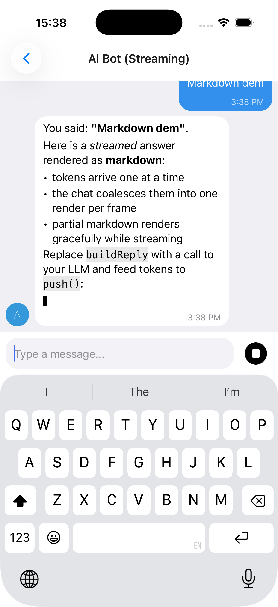
</p>

<details>
<summary><strong>useStreamingMessages, stop control and a full example</strong></summary>

The reply above streams in token-by-token (note the caret `▋`) and renders as **markdown** - bold, italics, lists, inline and fenced code - while the composer's send button turns into a **Stop** control mid-stream. See [Markdown rendering for AI replies](#markdown-rendering-for-ai-replies) to enable markdown.

- **`IMessage.streaming`** - flag a message as streaming (shows the caret)
- **`useStreamingMessages(...)`** - owns the message list, rAF-batches `push()`, and supports stop via `AbortController`. It returns `{ messages, setMessages, append, startStream, isStreaming, stop }`; `setMessages` is there for anything the hook does not cover, so you can patch a message with a plain `map`.

```tsx
import { useCallback } from 'react'
import { Chat, IMessage, useStreamingMessages } from '@kesha-antonov/react-native-chat'

function Bot () {
  const { messages, append, startStream, isStreaming, stop } = useStreamingMessages<IMessage>()

  const onSend = useCallback((newMessages: IMessage[] = []) => {
    append(newMessages[0])                      // show the user's message
    const stream = startStream({ user: { _id: 2, name: 'Assistant' } }) // empty streaming bubble

    runMyModel(newMessages[0].text, {
      signal: stream.signal,                    // aborts when stop() is called
      onToken: token => stream.push(token),     // batched, one render per frame
      onDone: () => stream.done(),              // clears the streaming flag
    })
  }, [append, startStream])

  return <Chat messages={messages} onSend={onSend} user={{ _id: 1 }} />
}
```

See **[docs/STREAMING.md](./docs/STREAMING.md)** for the full hook API and a real Claude streaming adapter (via a backend proxy). A runnable demo lives in `example/components/chat-examples/AIBotExample.tsx`.

</details>

#### Markdown rendering for AI replies

<details>
<summary><strong>Built-in renderer, or react-native-streamdown</strong></summary>

AI/LLM replies are usually markdown (bold, lists, fenced code). Enable markdown with `messageTextProps={{ markdown: true }}` (streamed messages auto-render as markdown unless you pass `markdown={false}`):

```tsx
// Force markdown for every message:
<Chat messageTextProps={{ markdown: true }} {...props} />

// Streamed messages auto-render as markdown; disable with markdown: false.
```

There are two renderers and you get the best available one automatically:

- **Built-in, zero-dependency renderer** (default). Covers headings, bullet/ordered lists, blockquotes, fenced + inline code, bold/italic/strikethrough, and links. It handles streaming-incomplete markdown gracefully (a half-written `**bold` or an unclosed code fence renders as plain text until complete), so it's safe to feed token-by-token. Nothing to install. Exposed as `BasicMarkdown` if you want to use it directly.

- **[`react-native-streamdown`](https://github.com/software-mansion-labs/react-native-streamdown)** (optional upgrade). When installed it's used instead, for richer streaming-safe markdown (tables, partial-table handling, etc.). It is a native module with its own peers - install the full set:

  ```bash
  npx expo install react-native-streamdown react-native-enriched-markdown remend katex
  ```

  It also requires `react-native-worklets >= 0.8.3` (i.e. `react-native-reanimated >= 4.3`), and `react-native-enriched-markdown` is a native module, so a dev build / prebuild is required (it does not work in Expo Go). 0.3 processes the markdown on a worklet runtime, which needs react-native-worklets' **Bundle Mode**: pass `bundleMode: true` and `importForwarding: { moduleNames: ['remend'] }` to `react-native-worklets/plugin` in `babel.config.js`, and wrap `metro.config.js` in `getBundleModeMetroConfig` from `react-native-worklets/bundleMode` (the example app does both). Until Bundle Mode is on, the chat keeps the built-in renderer and logs a one-time dev hint, since 0.3 throws on its first render without it. Version 0.3+ (`StreamdownText`) and the older `Streamdown` export are both recognised. The bubble's text color, size and link color are mapped onto its `markdownStyle`, so replies match the chat theme in light and dark. Anything in `markdownProps` is forwarded to `StreamdownText`; a `markdownStyle` there is merged per element over the derived one:

  ```tsx
  <Chat
    messageTextProps={{
      markdown: true,
      markdownProps: { markdownStyle: { codeBlock: { backgroundColor: '#0d1117' } } },
    }}
    {...props}
  />
  ```

</details>

### Emoji Reactions

Long-press a message to open a quick emoji picker; selected reactions render as pills in the bubble and toggle on tap. The bar's chevron opens the built-in full emoji grid (search, tabs, recents) in place; both ship in the core with no extra dependencies, and `renderExpandedPicker` / `renderReactionPicker` replace them.

<p align="center">
  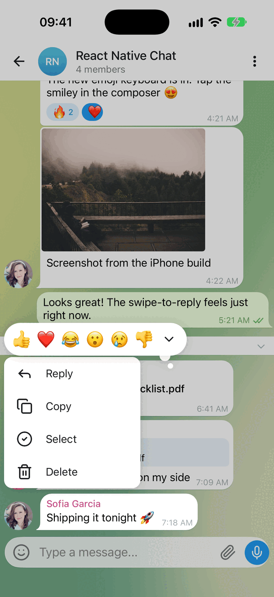
  &nbsp;&nbsp;
  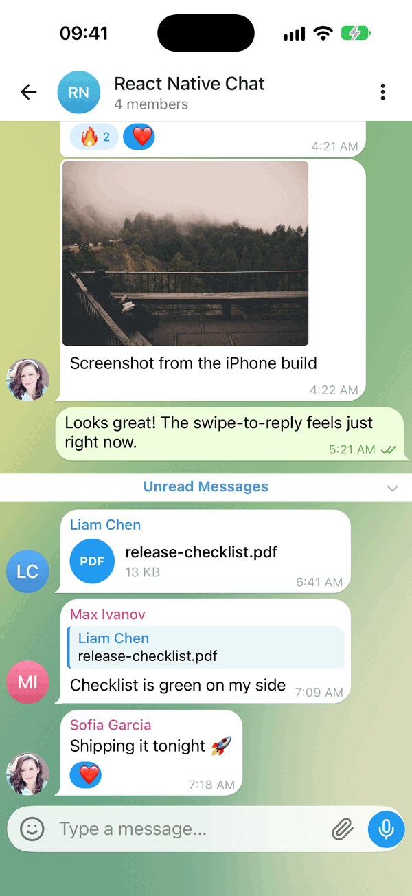
  &nbsp;&nbsp;
  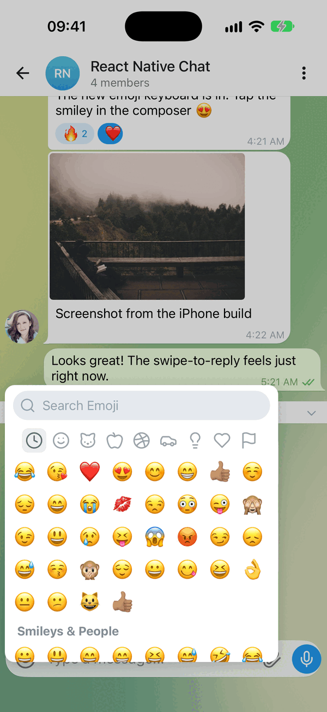
</p>

<details>
<summary><strong>Wiring up the toggle, and the full prop list</strong></summary>

Store reactions on each message as a `reactions` array and pass `reactions.onReactionPress` - that alone turns reactions on. `Chat.toggleReaction(messages, messageId, emoji, userId)` is the reducer, so the handler is one line. Reaction state is owned by you, so it works with any backend:

```tsx
interface IChatMessage extends IMessage {
  reactions?: MessageReaction[] // { emoji: string, userIds: (string | number)[] }[]
}

const CURRENT_USER_ID = 1

const handleReactionPress = useCallback((message: IChatMessage, emoji: string) => {
  setMessages(prev => Chat.toggleReaction(prev, message._id, emoji, CURRENT_USER_ID))
}, [])

<Chat
  messages={messages}
  onSend={onSend}
  user={{ _id: CURRENT_USER_ID }}
  reactions={{
    onReactionPress: handleReactionPress,
    // Optional: provide a richer picker (e.g. a full emoji browser).
    // See example/components/chat-examples/ReactionsExample.tsx
    // renderReactionPicker: props => <MyEmojiPicker {...props} />,
  }}
/>
```

`Chat.toggleReaction` (also exported as `toggleReaction`) returns a new array and leaves other messages untouched. A user has one reaction per message by default - picking another replaces it; pass `{ maxPerUser: Infinity }` (or any limit) as a fifth argument to allow more.

For a prototype, `useChatMessages({ initialMessages, user })` keeps the messages in local state and returns `chatProps` wired to sending, reactions, editing and deleting: `<Chat {...chatProps} />`.

#### Reactions Props (Grouped)

- **`isEnabled`** _(Bool)_ - Enable emoji reactions; default is on whenever `onReactionPress` is passed
- **`emojis`** _(String[])_ - Emojis shown in the quick picker (default `['👍', '❤️', '😂', '😮', '😢', '👎']`)
- **`onReactionPress`** _(Function)_ - `(message, emoji) => void` called when an emoji is selected or a pill is tapped. Apply it with `Chat.toggleReaction`
- **`renderReactions`** _(Function)_ - Override the reactions-display component rendered below the bubble
- **`renderReactionPicker`** _(Function)_ - Override the picker shown on long-press (use for a full emoji browser). It receives [`ReactionPickerProps`](src/Reactions/types.ts): `visible`, `message`, `emojis`, `onSelect`, `onDismiss`, `position`, the bubble's on-screen box (`pageX`, `pageY`, `bubbleWidth`, `bubbleHeight`), the two picker styles and:
  - **`messagePreview`** _(ReactNode, optional)_ - A copy of the pressed bubble to draw lifted above your backdrop at the bubble's box. While it is mounted the original bubble is hidden, so the message seems to rise out of the list; if you never render it, the original simply stays put. The easiest way to get the built-in look is to render the exported `ContextMenu` with `items={[]}` (see [Message actions](#message-actions-long-press-context-menu) for its props)
- **`renderExpandedPicker`** _(Function(`{ onSelect }`) | null, optional)_ - The expand button. The reactions bar (in the quick picker and above the context menu) ends in a chevron that grows the bar in place into a panel holding what this returns. Defaults to the built-in emoji grid (8 columns, search, tabs, recents); pass your own, or `null` to drop the button. Call `onSelect(emoji)` with the pick; the overlay closes and `onReactionPress` is called. Also passed to a custom `renderReactionPicker`
- **`containerStyle`**, **`reactionStyle`**, **`reactionActiveStyle`**, **`reactionTextStyle`**, **`reactionCountStyle`** - Styles for the reaction pills
- **`pickerContainerStyle`**, **`pickerEmojiStyle`** - Styles for the quick picker

</details>

### Smart Link Parsing

<details>
<summary><strong>URLs, emails, phones, hashtags and mentions</strong></summary>

Message text is automatically scanned for URLs, emails, and phone numbers; hashtags and mentions are opt-in. Configure it via `messageTextProps`:

```tsx
<Chat
  messageTextProps={{
    url: true,        // default true
    email: true,      // default true
    phone: true,      // default true
    hashtag: true,    // default false
    mention: true,    // default false
    hashtagUrl: 'https://example.com/hashtag',
    mentionUrl: 'https://example.com',
    linkStyle: { left: { color: '#1d9bf0' }, right: { color: '#fff' } },
    onPress: (message, url, type) => {
      // type: 'url' | 'email' | 'phone' | 'mention' | 'hashtag'
      Linking.openURL(url)
    },
  }}
/>
```

For full control, pass custom `matchers` (`{ type, pattern, getLinkUrl?, getLinkText?, renderLink?, onPress? }[]`) to add or override patterns. See the Links example in the [example app](#-example-app).

</details>

### Message actions (long-press context menu)

<details>
<summary><strong>Floating menu</strong></summary>

Long-press a message to open a context menu beside your finger. It opens by default with these actions: **Reply**, **Copy** (with `expo-clipboard` or `@react-native-clipboard/clipboard` installed), **Forward**, **Pin / Unpin**, **Edit** (your own text messages), **Select** and **Delete** - Forward, Pin, Edit and Delete appear once you pass `onForwardMessage`, `onPinMessage`, `onEditMessage` and `onDeleteMessage`. **Select** starts multi-select: check circles beside the messages and a Copy / Forward / Delete bar in the composer's place (see `onSelectionChange`). When reactions are enabled, a reactions row is shown on top of the menu automatically.

```tsx
<Chat
  messages={messages}
  onSend={onSend}
  user={user}
  onEditMessage={(message, text) => setMessages(prev => prev.map(m => m._id === message._id ? { ...m, text } : m))}
  onDeleteMessage={message => setMessages(prev => prev.filter(m => m._id !== message._id))}
/>
```

To change the set, pass `messageActions`. A function receives the built-in actions for the message (each with its `key`), so you can add, drop or reorder; an array replaces them. `defaultMessageActions` picks the built-ins by key, or turns them off with `false`.

```tsx
<Chat
  messageActions={(message, defaults) => [
    ...defaults.filter(action => action.key !== 'forward'),
    { label: 'Report', icon: ({ color, size }) => <Flag color={color} size={size} />, onPress: () => report(message) },
  ]}
/>
```

After 0.4s the menu opens with a haptic (if `expo-haptics` is installed). The message neither shrinks nor lifts - the chat dims under a black 0.2 scrim and the pressed message stays lit where it is. The menu - a 200-wide card of 48pt rows with icons, in `theme.contextMenu` colors - opens with its right edge just left of your finger and its top at it, unrolling from the top while each row drops into place. The reactions bar above it pops out from its right end with a slight overshoot, with a "thought bubble" tail; reactions you already picked sit smaller in a circle, and the chevron at its end grows the bar into the emoji panel. A picked reaction grows and flies into the message's reaction pill; an action runs once the menu has closed; a tap on the backdrop closes it all. Every animation runs on Reanimated and follows the system Reduce Motion setting. The reaction-only picker (`reactions` without `messageActions`) is the same overlay without actions.

A fully custom menu - each item is `{ key?, label, icon?, onPress, destructive? }`:

```tsx
import { setStringAsync } from 'expo-clipboard'
import { Copy, Trash2 } from 'lucide-react-native' // optional icons

<Chat
  messageActions={message => [
    { label: 'Copy', icon: ({ color, size }) => <Copy color={color} size={size} />, onPress: () => setStringAsync(message.text) },
    { label: 'Delete', icon: ({ color, size }) => <Trash2 color={color} size={size} />, destructive: true, onPress: () => deleteMessage(message) },
  ]}
/>
```

`ContextMenu` is exported for custom pickers and menus. Beyond `visible`, `items`, `onDismiss` (called once its exit has played), `position` and the bubble's box (`pageX`, `pageY`, `bubbleWidth`, `bubbleHeight`), it takes these optional props:

- **`reactions`** _(Object)_ - `{ emojis, onSelect, selected?, containerStyle?, emojiStyle?, renderAccessory?, renderExpandedPicker? }`. `selected` lists the reactions the user already picked (drawn smaller, in a circle); `renderAccessory` adds content at the end of the bar; `renderExpandedPicker` adds the expand button and the panel it opens (see `reactions.renderExpandedPicker` above)
- **`touchX`**, **`touchY`** _(Number)_ - Where the finger was, in window coordinates; the menu opens beside it (beside the bubble's middle without them)
- **`messagePreview`** _(ReactNode)_ - The copy of the message drawn above the scrim in place; pass the one a custom picker receives
- **`children`** _(ReactNode)_ - Drawn above everything else in the overlay, e.g. a full emoji sheet

> **Note:** This library no longer depends on `@expo/react-native-action-sheet`. Prefer `messageActions` above. If you specifically want a native action sheet, install it yourself, wrap your tree in `ActionSheetProvider`, and either call `useActionSheet()` in your own `onLongPressMessage` or pass an `actionSheet` prop - the `actionSheet` prop / `context.actionSheet()` escape hatch still works when you provide an implementation. The composer "+" actions use the built-in themed `AttachmentSheet` and need no setup.

</details>

### Interactive content inside bubbles (video players, maps)

<details>
<summary><strong>Keeping native controls tappable</strong></summary>

When `reactions` or `messageActions` are enabled, the long-press surface spans the **whole message row** - the bubble *and* the empty space beside it. (A tap gesture is added on top only when `onPressMessage` is set.) Those recognizers do not cancel touches on native subviews, so a `react-native-video` / `expo-video` player rendered through `renderMessageVideo` keeps its native `controls` interactive.

If a message must own every touch that lands on it, set `isMessageGestureEnabled` to `false` for it. The gesture surface then drops *behind* the bubble: the bubble's content takes its touches, and long-pressing the row next to the bubble still opens the picker - so reactions are never lost for that message.

```tsx
<Chat
  reactions={{ isEnabled: true, onReactionPress }}
  renderMessageVideo={props => <Video source={{ uri: props.currentMessage.video }} controls style={styles.video} />}
  // the video owns its controls; long-press beside the bubble still reacts
  isMessageGestureEnabled={message => !message.video}
/>
```

</details>

### Theming & Dark Mode

<details>
<summary><strong>Token groups, runtime switching and themed components</strong></summary>

The default look is a modern messenger style: a classic day theme (pale green outgoing bubbles over a green swirl wallpaper) and a dark blue night theme (a purple-to-blue outgoing gradient fixed to the screen). Every value is a token. Override any subset via `theme` (light) and `darkTheme` (dark); your overrides are deep-merged over `defaultLightTheme` / `defaultDarkTheme`, and the resolved theme switches at runtime with the color scheme (system, or forced via `colorScheme`). Explicit per-component style props still win over the theme.

```tsx
<Chat
  theme={{
    colors: { accent: '#3390EC', outgoingBubble: '#3390EC', outgoingText: '#FFFFFF' },
    radii: { bubble: 18 },
    wallpaper: { colors: ['#7FA381', '#FFF5C5', '#336F55', '#FBE37D'] },
  }}
  darkTheme={{ bubble: { outgoingGradient: ['#5B3FA8', '#2F6FD6'] } }}
  // colorScheme="dark"   // optional: force a scheme instead of following the system
  {...props}
/>
```

Token groups: `colors`, `radii`, `spacing`, `typography`, `avatar`, `sendButton`, `composer`, `voice`, plus:

- **`bubble`** - `hasTail` (a curled tail on the last bubble of a run; drawn with `react-native-svg` when installed), `isTimeInline` (the time on the last line of text when it fits; `false` gives it a row), `outgoingGradient` (stops, top to bottom, or `null` for the solid `colors.outgoingBubble`), `outgoingGradientMode` (`'screen'`: one gradient across the list, each bubble shows its slice; `'bubble'`: each bubble carries the whole gradient), `maxWidthInset` (the text column is `min(width, height) - maxWidthInset`, 80 by default), `bigEmojiMaxCount` (a message of up to this many emoji and nothing else drops its bubble and draws them large, with the time in a service pill; 20 by default, `0` turns it off), `bigEmojiSizes` (font size by emoji count, `40.8, 40.8, 33.6, 26.4, 22.8`).
- **`wallpaper`** - `isEnabled`, `colors` (three or four, for the swirl gradient), `isAnimated` (one step per outgoing message), `pattern` (an image tiled over the gradient; no pattern is bundled), `patternOpacity`, `patternColor`. Off, the chat shows `colors.background`. Replace it entirely with the `renderWallpaper` prop, or draw it elsewhere with the exported `ChatWallpaper` component.
- **`nameColors`** - the seven sender-name colors, picked per user id. Empty uses `colors.senderName`.
- **`avatar.palette` / `avatar.paletteEnd`** - initials avatar gradient stops, picked per user id. An empty `paletteEnd` draws flat colors.

A few behaviours follow from the tokens: setting `colors.outgoingBubble` turns the gradient off, setting `colors.senderName` empties `nameColors`, and setting `avatar.palette` without `paletteEnd` draws flat avatars - so an app that picks its own colors keeps seeing them. Bubbles in a run (same sender, at most five minutes apart, `utils.isSameGroup`) share one tail and one name, 2pt apart (`spacing.withinGroup`), with 6pt between runs (`spacing.betweenGroups`).

Build your own theme-aware components with the exported hooks:

```tsx
import { useTheme, useThemedStyles } from '@kesha-antonov/react-native-chat'
import { StyleSheet } from 'react-native'

const MyBadge = () => {
  const theme = useTheme()
  const styles = useThemedStyles(t => StyleSheet.create({
    badge: { backgroundColor: t.colors.accent, borderRadius: t.radii.bubble },
  }))
  return <View style={styles.badge} />
}
```

Also exported: `defaultLightTheme`, `defaultDarkTheme`, `ChatWallpaper`, and the `ChatTheme` / `PartialChatTheme` types.

</details>

### Localization (i18n)

<details>
<summary><strong>Built-in translations and label overrides</strong></summary>

All built-in UI strings (composer placeholder, send/cancel, load earlier, today, voice/video/location labels, slide-to-cancel, reply/edit banner, camera-permission text) route through a label table. Built-in translations ship for `es`, `fr`, `de`, `ru`, `zh`, `ar`, `pt`, `ja`, `ko`, `it`, `tr`, `hi`, `nl`, `pl` and `id`, with English as the default, selected by the existing `locale` prop. A regional tag falls back to its base language, so `pt-BR` resolves to `pt`. Override any individual string with `labels`:

```tsx
<Chat
  locale="fr"                       // pick a built-in translation
  labels={{ placeholder: 'Votre message...' }}  // override any string
  {...props}
/>
```

Exported helpers: `ChatLabels` (type), `defaultLabels`, `translations`, `resolveLabels`, and the `useLabels` hook for reading the resolved labels in custom components.

</details>

### Message Status

<details>
<summary><strong>Tick indicators for sent / delivered / read</strong></summary>

Set `sent`, `received`, `pending` or `isFailed` on a message to show its delivery status. They render beside the time: one check once sent, two once received (read), a spinning clock while pending, a red badge when sending failed. `isEdited` or `editedAt` prefix the time with "edited":

```tsx
const message: IMessage = {
  _id: 1,
  text: 'Delivered!',
  createdAt: new Date(),
  user: { _id: 1 },
  sent: true,
  received: true,
}
```

Customize the indicators with `renderTicks` (full override) or `tickStyle` (style only):

```tsx
<Chat
  renderTicks={message => (message.received ? <MyReadIcon /> : null)}
  tickStyle={{ color: '#1d9bf0' }}
/>
```

</details>

### TypeScript

<details>
<summary><strong>Generic over your own message type</strong></summary>

Chat ships complete type definitions and is generic over your message type. Extend `IMessage` to add custom fields and everything stays typed end to end:

```tsx
import { Chat, IMessage } from '@kesha-antonov/react-native-chat'

interface MyMessage extends IMessage {
  reactions?: { emoji: string, userIds: (string | number)[] }[]
}

<Chat<MyMessage>
  messages={messages}
  onSend={msgs => {/* msgs is typed as MyMessage[] */}}
  user={{ _id: 1 }}
/>
```

</details>

---

## 📱 Platform Notes

### Android

<details>
<summary><strong>Keyboard configuration</strong></summary>

If you are using Create React Native App / Expo, no Android specific installation steps are required. Otherwise, we recommend modifying your project configuration:

Make sure you have `android:windowSoftInputMode="adjustResize"` in your `AndroidManifest.xml`:

```xml
<activity
  android:name=".MainActivity"
  android:label="@string/app_name"
  android:windowSoftInputMode="adjustResize"
  android:configChanges="keyboard|keyboardHidden|orientation|screenSize">
```

For **Expo**, you can append `KeyboardAvoidingView` after Chat (Android only):

```jsx
<View style={{ flex: 1 }}>
   <Chat />
   {Platform.OS === 'android' && <KeyboardAvoidingView behavior="padding" />}
</View>
```

</details>

### Web (react-native-web)

Install the web renderer alongside the library:

```bash
yarn add react-native-web react-dom
```

<details>
<summary><strong>Expo / Metro (recommended) - no extra config</strong></summary>

```bash
npx expo start --web
```

Nothing else to set up. Metro runs Babel over `node_modules`, so this package's JSX and its Reanimated worklets get transpiled the same way your own code does. The [example app](#-example-app) runs on web exactly like this.

</details>

<details>
<summary><strong>Other bundlers (webpack, Vite, Next.js) - the package must be transpiled</strong></summary>

The published files are ES modules with JSX left in place, and the component uses Reanimated worklets, which need `react-native-reanimated/plugin` to run. Bundlers that skip `node_modules` when transpiling - webpack's `babel-loader` does by default - will choke on that. So outside Metro you need to:

1. Alias `react-native` to `react-native-web` and let the resolver pick up `.web.js` / `.web.tsx` extensions
2. Run `@kesha-antonov/react-native-chat` - and the React Native packages it depends on - through Babel with `@react-native/babel-preset` and `react-native-reanimated/plugin`, instead of excluding all of `node_modules`

In Next.js that is `transpilePackages` in `next.config.js`; in a plain webpack setup it means widening the `babel-loader` rule's `exclude` so these packages are included.

</details>

### React Strict DOM

<details>
<summary><strong>Works inside an RSD tree - verified on iOS and Expo web</strong></summary>

Chat drops into a [React Strict DOM](https://github.com/facebook/react-strict-dom) app unchanged. RSD's native build renders through React Native, so `<Chat>` is just another RN subtree:

```tsx
import { css, html } from 'react-strict-dom'
import { Chat } from '@kesha-antonov/react-native-chat'

const styles = css.create({
  root: { display: 'flex', flexDirection: 'column', height: '100%' },
})

<html.div data-layoutconformance='strict' style={styles.root}>
  <Chat messages={messages} onSend={onSend} user={user} />
</html.div>
```

Three things to know:

- **Web needs `react-native-web`.** RSD's web build contains no React Native code at all, so Chat does not resolve there on its own. Expo web gives you `react-native-web` already, so RSD (real DOM) and Chat (RNW's DOM output) render side by side in one tree. A Vite or Next.js RSD app has to add the alias and transpile step from the section above
- **Metro needs `unstable_enablePackageExports: true`.** RSD publishes only an `exports` map with no `main`, so with package exports off it fails to resolve. This is the default on recent Expo SDKs
- **StyleX styles do not reach Chat.** It takes React Native style objects and its own `theme` prop, not `css.create` output. On native, `compat.native` is the bridge if you want RSD to drive a wrapper around it

</details>

---

## ⚡ Performance

The chat is built for long lists. The one habit that matters most: **memoize your render props and config**, because each message row is `React.memo`'d with a comparator that deep-compares the message and reference-compares everything else - so an inline function or object re-renders that row on every parent render.

```jsx
// ❌ New reference every render - the row can't skip
<Chat renderBubble={props => <MyBubble {...props} />} reactions={{ isEnabled: true, onReactionPress }} />

// ✅ Stable references - unchanged rows skip re-renders
const renderBubble = useCallback(props => <MyBubble {...props} />, [])
const reactions = useMemo(() => ({ isEnabled: true, onReactionPress }), [onReactionPress])

<Chat renderBubble={renderBubble} reactions={reactions} />
```

<details>
<summary><strong>Immutability, context props and virtualization tuning</strong></summary>

The memoization advice applies to all render props (`renderBubble`, `renderMessageText`, `renderAvatar`, ...), the `reactions` / `audioRecording` / `videoRecording` / `messageActions` config objects, and any style objects.

**Keep messages immutable.** Update messages by creating new arrays/objects (e.g. `Chat.append(...)`), never by mutating an existing message in place - the row comparator relies on value changes to detect updates.

**Theme, icons and labels don't need drilling.** `theme` / `darkTheme`, `icons`, and `labels` are read from context (`useTheme`, `useIcons`, `useLabels`), so passing them once on `<Chat>` is enough; they don't cause per-row churn.

**Tune virtualization if needed.** Sensible `FlatList` defaults ship out of the box (`removeClippedSubviews` on Android, `initialNumToRender`, `maxToRenderPerBatch`, `windowSize`, `updateCellsBatchingPeriod`). `windowSize` is measured in screen-heights (not messages); the default keeps a few screens of content mounted around the viewport. Override any of them via `listProps`:

```jsx
<Chat listProps={{ windowSize: 7, removeClippedSubviews: true }} {...props} />
```

</details>

### FlashList (opt-in)

<details>
<summary><strong>Recycling rows on very long histories</strong></summary>

On long histories `FlatList` can log `VirtualizedList: You have a large list that is slow to update`. [FlashList](https://shopify.github.io/flash-list/) v2 recycles rows instead of keeping them mounted, which removes that class of stall. It is supported as an **optional** dependency - install it yourself and flip one prop:

```bash
yarn add @shopify/flash-list
```

```jsx
<Chat messages={messages} user={user} isFlashListEnabled />
```

Everything else keeps working: `isInverted`, the floating day header, `loadEarlierMessagesProps` infinite scroll, the scroll-to-bottom button, and `listProps` (spread last, so it overrides the defaults below).

The chat sets FlashList's `maintainVisibleContentPosition` for you - `startRenderingFromBottom` when `isInverted={false}`, plus `autoscrollToBottomThreshold: 0.2` so new messages follow the viewport only when you are already at the bottom. Override it through `listProps` if you want different thresholds:

```jsx
<Chat
  isFlashListEnabled
  listProps={{
    maintainVisibleContentPosition: {
      autoscrollToBottomThreshold: 0.1,
      animateAutoScrollToBottom: false,
    },
  }}
  {...props}
/>
```

Notes:

- FlashList v2 requires the **New Architecture**. On the old architecture it falls back to a slower JS path.
- `FlatList`-only knobs (`windowSize`, `maxToRenderPerBatch`, `initialNumToRender`, `updateCellsBatchingPeriod`, `removeClippedSubviews`) are not forwarded to FlashList - it sizes its own render window.
- If `@shopify/flash-list` is not installed, the prop is ignored, a warning is logged, and `FlatList` is used.

</details>

---

## 🧪 Testing

<details>
<summary><strong>Triggering layout events in tests</strong></summary>

`TEST_ID` is exported as constants that can be used in your testing library of choice.

React Native Chat uses `onLayout` to determine the height of the chat container. To trigger `onLayout` during your tests:

```typescript
const WIDTH = 200
const HEIGHT = 2000

const loadingWrapper = getByTestId(TEST_ID.LOADING_WRAPPER)
fireEvent(loadingWrapper, 'layout', {
  nativeEvent: {
    layout: {
      width: WIDTH,
      height: HEIGHT,
    },
  },
})
```

</details>

---

## 📦 Example App

<details>
<summary><strong>Running the demo locally</strong></summary>

The repository includes an example app with two parts. The **Chats** tab is a small messenger built on the defaults: a chat list (unread badges, pinned and muted chats, "typing…" previews, swipe to archive, long-press selection, a compose button) where each chat is a bare `<Chat>` with seeded history, and sending moves the chat to the top and gets a simulated reply. The **Explore** tab has one screen per feature or customization: streaming AI replies, reactions, the long-press menu, media and voice, theming, localization, links, custom rendering, a Slack-style layout, and more.

```bash
git clone https://github.com/kesha-antonov/react-native-chat.git
cd react-native-chat/example
yarn install

npx expo run:ios       # iOS
npx expo run:android   # Android
npx expo start --web   # Web
```

</details>

---

## ❓ Troubleshooting

<details>
<summary><strong>"Cannot read property 'Chat' of undefined"</strong></summary>

This means the package threw while it was being loaded, so the import came back empty. The real cause is the **first** error in the Metro log or red box, logged before this one - almost always a native peer that is missing or out of sync with the installed app:

- `react-native-reanimated`, `react-native-worklets`, `react-native-gesture-handler` and `react-native-keyboard-controller` are native modules. After installing or upgrading any of them, rebuild the app (`npx expo run:ios`, `npx expo prebuild`, or `pod install` + a native build) - reloading the JS bundle is not enough.
- In Expo, install them with `npx expo install` so the versions match your SDK. A plain `npm install` pulls the latest releases, which Expo Go and an existing dev build may not include, and Reanimated throws a version-mismatch error on import.
- In bare React Native, check the worklets Babel plugin is in `babel.config.js` (see [Bare React Native Projects](#bare-react-native-projects)), then restart Metro with `--reset-cache`.

</details>

<details>
<summary><strong>The whole message list is blurred on iOS 26</strong></summary>

The chat sits under a transparent navigation header - Expo Router 58's default is a transparent Liquid Glass header the screen scrolls under. iOS 26 then blurs scroll content beneath the header with a scroll edge effect, and because the message list is inverted, that blur covers every message instead of a strip at the top. Give the chat screen an opaque header:

```tsx
<Stack.Screen name='chat' options={{ headerTransparent: false }} />
```

</details>

<details>
<summary><strong>TextInput is hidden on Android</strong></summary>

Make sure you have `android:windowSoftInputMode="adjustResize"` in your `AndroidManifest.xml`. See [Android configuration](#android) above.

</details>

<details>
<summary><strong>How to set Bubble color for each user?</strong></summary>

See [this issue](https://github.com/kesha-antonov/react-native-chat/issues/672) for examples.

</details>

<details>
<summary><strong>How to customize InputToolbar styles?</strong></summary>

See [this issue](https://github.com/kesha-antonov/react-native-chat/issues/662) for examples.

</details>

<details>
<summary><strong>How to manually dismiss the keyboard?</strong></summary>

See [this issue](https://github.com/kesha-antonov/react-native-chat/issues/647) for examples.

</details>

<details>
<summary><strong>How to use renderLoading?</strong></summary>

See [this issue](https://github.com/kesha-antonov/react-native-chat/issues/298) for examples.

</details>

---

## 🤔 Have a Question?

1. Check this README first
2. Search [existing issues](https://github.com/kesha-antonov/react-native-chat/issues)
3. Ask on [StackOverflow](https://stackoverflow.com/questions/tagged/kesha-antonov/react-native-chat)
4. Open a new issue if needed

---

## 🤝 Contributing

Contributions are welcome - fork, branch, and open a Pull Request.

### Development Setup

<details>
<summary><strong>Commands</strong></summary>

```bash
yarn install          # install dependencies
yarn build            # build the library
yarn test             # run tests
yarn lint             # run linting
yarn prepublishOnly   # full validation
```

Before opening a PR, please make sure `yarn test`, `yarn lint` and `yarn build` all pass.

</details>

---

## 👥 Authors

Based on [FaridSafi/react-native-gifted-chat](https://github.com/FaridSafi/react-native-gifted-chat), which is no longer actively maintained.

**Maintainer:** [Kesha Antonov](https://github.com/kesha-antonov)

I also build **[cryptoc](https://cryptoc-app.web.app/)** - a crypto portfolio app with home screen, lock screen and Watch widgets, no account and no exchange API keys.

> I maintained the original project solo for 2 years before deciding to continue development in this repository. If you find this library useful, please consider [becoming a sponsor](https://github.com/sponsors/kesha-antonov) to support continued development. 💖

---

## 📄 License

[MIT](LICENSE)

---

<p align="center">
  <sub>Built with ❤️ by the React Native community</sub>
</p>
